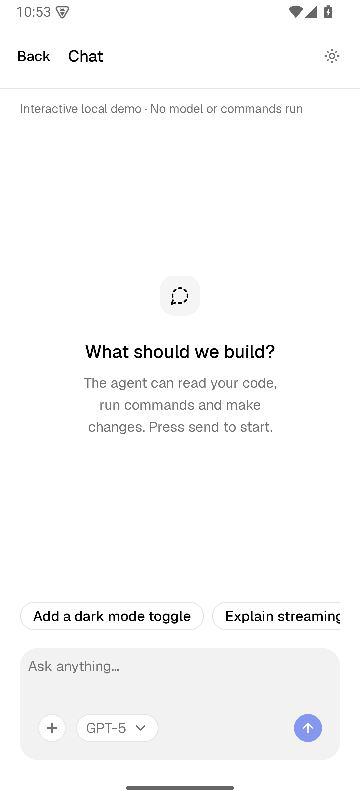
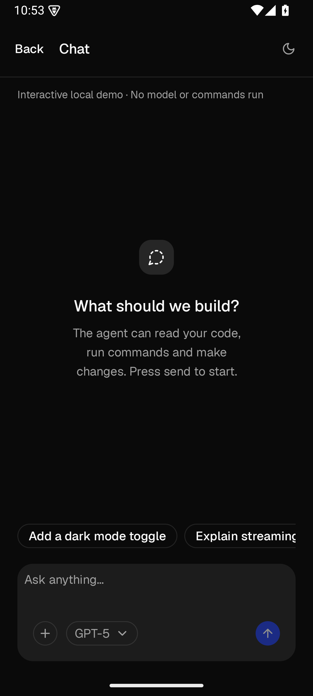
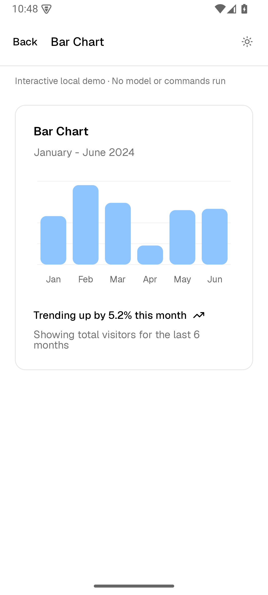
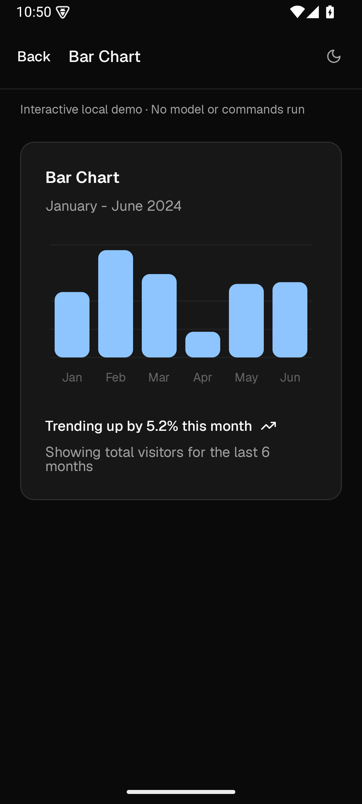
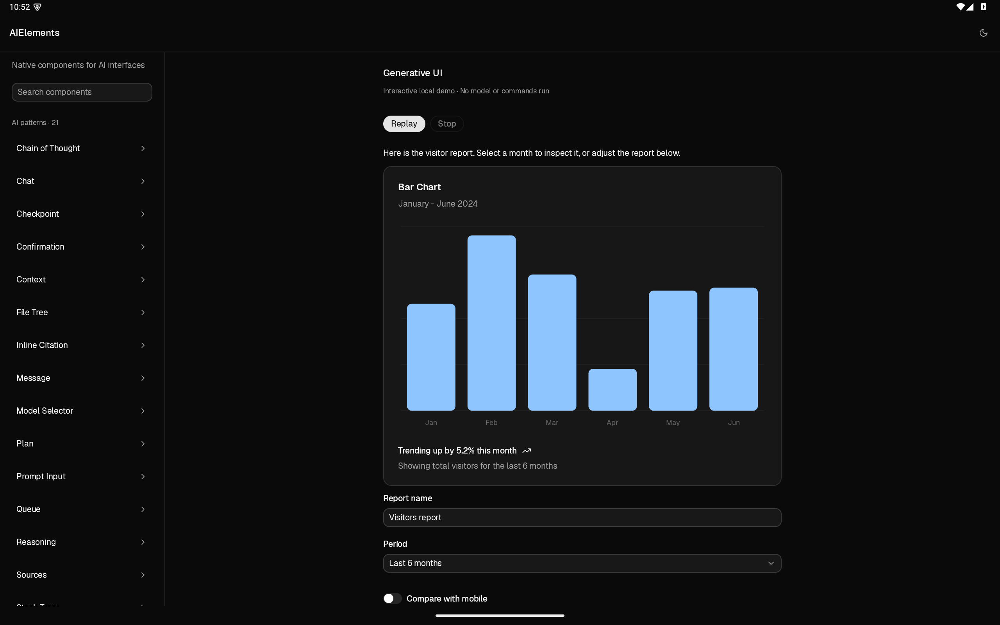

# Android validation

## 2026-11-11 merge validation

The Android port was prepared from `codex/android-port` against `main` at `062ad7168b16460fb6a4f874265f973d5eb1ba6c`; the remote base had no intervening changes.

- Fresh Android JVM tests: **15 protocol + 3 chart geometry passed**, no failures or skipped cases.
- Fresh macOS Swift regression: **51 tests passed** (11 protocol, 31 components, 9 CLI).
- Debug gallery APK and release Compose AAR built; library and gallery Lint: **0 errors**, 13 library warnings and 1 gallery warning.
- The immediately preceding final-source device run remains **23/23 passed**, with 74 same-width screenshot pairs and 27 native viewport captures. The merge preparation changes only README/validation links and Windows wrapper line-ending attributes; Android runtime source is unchanged from that run.
- Staging excludes local SDK/JDK configuration, caches, private signing files and compiled APK/AAR files. Windows wrapper checkout retains CRLF via a scoped `.gitattributes` rule.
- Repository delivery only: no production service, Pages site, Android release signing or application-store deployment is configured.

## 2026-11-11 fourth visual fidelity pass (latest)

Branch: `codex/android-port`. Dark input surfaces now use 4.5% white, and Input/Select content insets account for the website border box. Visible height and independent 48 dp targets are unchanged.

- Fresh website + Android: **74 pairs / 37 states**, individually reviewed at 360 CSS px / 360 dp. Reference content and natural dimensions match the prior capture. Theme transitions are settled; scrolled-page crops use document coordinates.
- **23/23 device tests passed**; debug APK, test APK and release AAR built; Lint **0 errors / 13 warnings**.
- **27 native viewport captures reviewed**: Input, Select and gallery Report card; phone portrait/landscape and tablet portrait/landscape in both themes, plus 1.3× phone text. Login card is covered by the same-width fixture, not the gallery Report card. All foreground guards passed, with no obstructed capture accepted.
- Six Android captures changed (Card/Input/Select light/dark), 68 remain byte-identical; all natural heights unchanged. Device display and font overrides restored afterward.
- Remaining differences: 48 dp interaction density, message action spacing, code wrapping, typography and rasterization. Error/chart color values verified against browser conversion; not arbitrarily tuned to JPEG colors. No new physical-device/minimum-API coverage.

[Current report](Android-Visual-Fidelity-2026-11-11.md) · [74-pair gallery](Images/AndroidFidelity-2026-11-11/index.html) · [Evidence](../Reference/android-visual-fidelity-evidence-2026-11-11.json).

| Artifact | SHA-256 |
| --- | --- |
| [gallery-debug.apk](../Android/gallery/build/outputs/apk/debug/gallery-debug.apk) | `0a233fc7c81af0320562d6a765d36eaf9a21eda755ecc7623387486bb86cdee8` |
| [aielements-release.aar](../Android/aielements/build/outputs/aar/aielements-release.aar) | `397905dd216490a00f531cd653515b1efc22f5fb913e344f9d4101d8f471cd58` |

Selected native evidence: [large-font Select](Images/AndroidFidelityNative-2026-11-11/phone-large-select.png), [portrait tablet Input](Images/AndroidFidelityNative-2026-11-11/tablet-portrait-input-dark.png), [landscape tablet Select](Images/AndroidFidelityNative-2026-11-11/tablet-landscape-select-dark.png).

## 2026-11-11 third visual precision pass

Branch: `codex/android-port`. Table separators are painted within rows, cell widths use their actual font weights, and the chat reset surface aligns to the top/end inside its unchanged 48 dp touch target.

- Fresh website and Android capture: **74 pairs / 37 states**, all individually reviewed at 360 CSS px / 360 dp. All reference text, state and measured sizes match the previous reference; charts and progress were explicitly captured after animations completed.
- Table height: **374.86 → 371.43 dp**, website **371.50 px**. Only Chat/Table light/dark changed in Android captures; the other 70 images match the previous Android capture bytes.
- Full device regression: **23/23 passed**, including new 1.5× font / 320 dp table scrolling and row-separation coverage, reset callback, target separation, and all matched captures.
- Debug APK and release AAR built successfully. Lint: **0 errors / 13 warnings**. Protocol and chart geometry unchanged; their unit tests were not repeated this pass.
- **20 fresh native viewport screenshots** reviewed: 6 phone portrait, 2 large text, 4 phone landscape, 4 tablet portrait, 4 tablet landscape. Chat and Table covered in each orientation/theme; Message included on phones because it uses icon buttons. Initial System UI ANR prevented capture; after reboot the foreground guard passed for all 20. Device display and font settings restored afterward.
- Remaining differences: independent 48 dp interactive rows/actions, card footer spacing, code wrapping, small font/border differences and chart tint. No claim of pixel equality or new physical-device/minimum-API coverage.

[Current comparison report](Android-Visual-Precision-2026-11-11.md) · [74-pair gallery](Images/AndroidPrecision-2026-11-11/index.html) · [Evidence and fingerprints](../Reference/android-visual-precision-evidence-2026-11-11.json).

Current outputs: [Gallery APK](../Android/gallery/build/outputs/apk/debug/gallery-debug.apk), [Compose AAR](../Android/aielements/build/outputs/aar/aielements-release.aar).

| Artifact | SHA-256 |
| --- | --- |
| gallery-debug.apk | `c6ea0252c8c72dbdd9280ab35ecacfbc6ee6b00f4499ffb1ec47d72730bf4f8f` |
| aielements-release.aar | `2d3f8b7c3febfd88e4912abbc2d881c6426cfaa0cc6a606fe1ddf213a5fd2baf` |

Selected native evidence: [phone chat](Images/AndroidPrecisionNative-2026-11-11/phone-chat-light.png), [large-font table](Images/AndroidPrecisionNative-2026-11-11/phone-large-table.png), [portrait tablet chat](Images/AndroidPrecisionNative-2026-11-11/tablet-portrait-chat-dark.png), [landscape tablet table](Images/AndroidPrecisionNative-2026-11-11/tablet-landscape-table-dark.png).


## 2026-11-11 second visual polish

Branch: `codex/android-port`. Card body/footer spacing, trace prose, code line-number spacing, checkpoint tone, chat header/empty state and responsive approval layout now use the revised public Compose components. The gallery uses the real chat reset callback. Card and chat comparison fixtures call these public APIs; no screenshot-only style overrides were added.

See the [37-state report](Android-Visual-Polish-2026-11-11.md), [74 paired images](Images/AndroidPolish-2026-11-11/index.html), and [provenance / artifact fingerprints](../Reference/android-visual-polish-evidence-2026-11-11.json).

- Builds: debug gallery APK and release AAR successful; library Lint **0 errors / 13 warnings**.
- Device validation: **22 unique tests passed**. Full regression ran 21 tests; after the final narrow-approval change, 3 targeted tests covered the new narrow-layout callback, existing approval retry, and all 74 captures. Chart geometry: 3 unit tests passed earlier in this pass; protocol unchanged.
- Fresh matched captures: all 74 at 360 dp, API 35, density 2.625, font scale 1.0. Final capture bytes match the reviewed pairs exactly. Website images use the complete November 11 reference, not a new browser capture in this pass.
- Gallery: 33 viewport captures (18 phone light/dark, 5 large-font, 2 phone landscape, 8 tablet portrait/landscape), with 9 final targeted refreshes for approval and completed streaming dashboards. Process-alive and foreground-window checks passed. Obstructed attempts were discarded.
- Source diff reviewed; no overlap or clipping found in the checked final states. Retained differences: independent 48 dp interactive rows/actions, small font/border differences, and dark area-fill tint. The report does not claim pixel equality.

Outputs from that pass: [Gallery APK](../Android/gallery/build/outputs/apk/debug/gallery-debug.apk), [Compose AAR](../Android/aielements/build/outputs/aar/aielements-release.aar).

| Artifact | SHA-256 |
| --- | --- |
| gallery-debug.apk | `4803bb629cab8612573895d161aaea224e8c989ed669280b764a320e1d024011` |
| aielements-release.aar | `f121f0420716b28b67d964338691114a45b2d6acb4b73a7dfaf1bcbf4382bdae` |

Selected native evidence: [phone chat](Images/AndroidPolishNative-2026-11-11/phone-chat-light.png), [large-font chat](Images/AndroidPolishNative-2026-11-11/phone-large-text-chat.png), [large-font approval](Images/AndroidPolishNative-2026-11-11/phone-large-text-confirmation.png), [phone landscape](Images/AndroidPolishNative-2026-11-11/phone-landscape-chat-dark.png), [portrait tablet dashboard](Images/AndroidPolishNative-2026-11-11/tablet-portrait-generative-ui-dark.png), [landscape tablet chat](Images/AndroidPolishNative-2026-11-11/tablet-landscape-chat-dark.png).

Local logs: `.build/android-polish2-2026-11-11/reflow-build-final.log`, `verification.log`, `reflow-verification.log`, `gallery.log`, `refresh-gallery.log`. The original emulator was offline; verification used a fresh isolated device with the same API, density and display configuration. A Gradle device-discovery attempt was abandoned, then the same built test APK was run directly with AndroidJUnitRunner. Capture restores display size, density and font scale. Physical devices and minimum-API coverage remain outside this pass.


## 2026-11-11 visual refinement

Branch: `codex/android-port`. This pass changes actual Compose typography, prompt controls, inline code/citations, card spacing, list spacing and overflow fades. The matched capture fixtures are unchanged. See the [37-state correction report](Android-Visual-Refinement-2026-11-11.md) and [74-image theme-switchable gallery](Images/AndroidRefinement-2026-11-11/index.html).

- Debug gallery APK and release library AAR build successfully; Android Lint reports **0 errors / 13 warnings** (dependency-update notices and existing optional `Modifier` parameter ordering).
- **19 device tests pass** on API 35: 18 behavior/rendering tests plus one batch capture of 74 matched component/theme states. Three added checks cover separate queue-row hit regions and edge-tap callbacks, 1.3× prompt-menu reflow without overlap, and readable inline-code semantics with wrapping of long tokens.
- **3 chart geometry unit tests pass** in this correction pass. Protocol code is unchanged; the 15 protocol tests below are the previous validation record and were not rerun for this visual change.
- **95 gallery viewport captures** completed with process-alive checks, covering phone light/dark, 1.3× font scale, phone landscape, and tablet portrait/landscape. A targeted final refresh covers 14 message/trace/code-related gallery states after the last clipping adjustment. All 74 matched native component captures were also refreshed from the final source.
- Direct inspection covers all 74 matched comparisons and the large-type, landscape and tablet viewports. No new text clipping or overlapping prompt menus was observed in those checked states. Existing differences in 48 dp interactive rows, text rendering and area-fill color remain documented; this is not a pixel-equivalence claim.

Deliverables at that point (hashes below are historical): [Gallery APK](../Android/gallery/build/outputs/apk/debug/gallery-debug.apk) and [Compose AAR](../Android/aielements/build/outputs/aar/aielements-release.aar). Both files are local build outputs.

| Artifact | SHA-256 |
| --- | --- |
| gallery-debug.apk | `f9012005bfdc7a3f7a327df66dbc23581cb2fc54f6aeb23a777008b09522e93a` |
| aielements-release.aar | `868aab30e0f4b03de5a5ebb0c4d60a404f83c9e86301b396ae65192f9462f5c6` |

Evidence from that pass: [large-text prompt](Images/AndroidRefinementNative-2026-11-11/phone-large-text-prompt-input.png), [large-text chart and wrapping footer](Images/AndroidRefinementNative-2026-11-11/phone-large-text-generative-ui.png), [landscape chat](Images/AndroidRefinementNative-2026-11-11/phone-landscape-chat-dark.png), [portrait tablet](Images/AndroidRefinementNative-2026-11-11/tablet-portrait-area-chart-dark.png), [landscape tablet](Images/AndroidRefinementNative-2026-11-11/tablet-light.png). Native screenshot provenance is recorded [here](Images/AndroidRefinementNative-2026-11-11/provenance.json); comparison geometry and official source URLs are recorded [here](../Reference/android-visual-refinement-2026-11-11.json).

The test/capture logs and raw native images are local under `.build/android-refine-2026-11-11/`; official web screenshots are from the fresh same-day audit under `.build/android-recheck-2026-11-11/web/`. Capture scripts restore display size/density and font scale. Physical-device and minimum-API coverage remain outside this pass. This correction was reviewed directly; no new independent reviewer was invoked.

## 2026-11-10 baseline record

Implementation: `codex/android-port`, native Kotlin / Jetpack Compose under `Android/`. This record includes the visual-parity correction pass; the original Swift products and Xcode examples remain unchanged.

## Build and automated checks

- Gallery debug APK and Compose library release AAR build successfully. API 26+, compile / target SDK 35, JDK 17.
- Protocol JVM tests: **15 passed**, using the existing Swift protocol fixtures directly.
- Chart geometry JVM tests: **3 passed**, checking axis bounds, invalid values, degenerate/linear data, natural endpoint curvature and continuous interior curvature.
- Native Compose instrumentation: **16 passed**, zero failures/errors on the Android 15 / API 35 ARM64 emulator. This comprises 15 interaction/rendering tests and one batch capture test covering 74 component/theme states.
- Android Lint: no errors. Remaining warnings concern dependency updates and optional Compose `Modifier` parameter ordering. Dependencies remain pinned.
- Gradle 8.11.1 distribution SHA-256 is pinned in the wrapper.

Protocol coverage includes all 16 shared documents, the complete dashboard JSONL stream, every byte-split point through Chinese/emoji UTF-8, final unterminated lines, truncation/oversize/invalid UTF-8 rejection, valid-frame delivery before an invalid frame, transactional validation, revision ordering, failed-surface recovery, preserved local edits, explicit action state export, cycles/multiple parents/depth limits, invalid controls/charts and serialization round trips.

The 15 device interaction/rendering tests cover empty-send disabling and Stop, retry after approval callback failure, nested file-tree expansion and selection, Select binding before callbacks, interrupted UI preservation, 48 dp touch targets, composing all shared foundation fixtures in both themes, recoverable oversized-input validation, invoice amounts visible within 360 dp, inline citation touch bounds and source dialog, framework-frame expansion and source callbacks, test-suite grouping, context menu and switch interactions, chart data access by long press, and empty-chat visibility in a short landscape pane.

The wider gallery pass also exposed a duplicate list key when a tall tablet viewport displayed both the Generative UI section title and its entry; section and component keys now use separate prefixes. Short landscape windows use a single pane and a compact chat empty state.

The visual correction pass fixed component structure and tokens, not just screenshot fixtures. Public APIs now support card header/footer slots, configurable chat empty states, grouped test suites and framework frames, real inline citation layout, naturally interpolated charts and content-sized table columns. The [comparison report](Android-Visual-Comparison.md) lists each correction and remaining difference.

## Native visual evidence

**Matched comparisons:** 36 components, 37 example states, light/dark = 74 captures. Compose draws the actual components on the emulator, with a strict 360 dp width assertion, default font scale and density 2.625. Semantic actions align expanded states without transient touch ripples. The report uses 18 official web screenshots captured November 10 and 56 archived November 8 screenshots; this pass does not claim all official pages were freshly recaptured.

**Gallery regression:** the installed APK is also exercised by [the capture script](../Scripts/capture-android.py), which launches gallery destinations and captures the real display:

```sh
python3 Scripts/capture-android.py --adb /path/to/adb --serial emulator-5554
```

The script covers the catalog, all 21 AI patterns, all 15 foundations and the streaming dashboard in light/dark at 360 dp phone width. Additional captures cover 1.3× font scale for Chat, Confirmation, Inline Citation, Prompt Input, Table, Card and Generative UI; phone landscape for Chat, Prompt Input and Table in both themes; and tablet portrait/landscape in both themes. Tablet sizes are emulator display configurations, not physical tablet evidence. Each capture checks that the gallery process is still alive; display size, density and font scale are restored after capture. Scrollable pages are inspected as viewports, not presented as full-content screenshots.

Raw component evidence is local under `.build/android-visual-audit/android/`; the public 74 paired images are under `Documentation/Images/AndroidComparison/`. Gallery regression captures are local under `.build/android-visual-fix/gallery/`, with selected previews retained in `Documentation/Images/Android/`.

The final targeted rerun refreshed Chat after the short-height correction and the two light-theme color refinements. The 95 gallery viewport captures completed with the process-alive check; phone size/density and font scale were restored to 1080×2400 / 420 dpi / 1.0.

[Phone landscape after correction](Images/Android/chat-landscape-dark.png) · [Tablet portrait after correction](Images/Android/tablet-portrait-light.png)

## Remaining platform differences and limits

Android retains 48 dp interactive targets, native menus/dialogs and system Back. Visible button/input/switch surfaces are compact, but lists with clickable rows remain taller than the website. Font rasterization, some line breaks/baselines, border rounding and color compositing differ. In particular, browser/native area-fill compositing is visibly different in dark mode. These are documented differences, not a claim of pixel equivalence.

The tests are behavioral/rendering checks, not screenshot similarity assertions. Physical devices, minimum API 26, every intermediate OS version, TalkBack traversal, process-death restoration, hardware keyboards, external file-provider failures and release/store signing have not been fully validated. Model networking and real command execution remain host responsibilities; the gallery is local.

The earlier independent review covered the initial port and resolved short-label touch width and recoverable input validation. No new independent reviewer was invoked for this correction pass; the current evidence is the automated regression and direct image inspection described above.

## Selected native previews

| Phone — light | Phone — dark |
| --- | --- |
|  |  |
|  |  |


