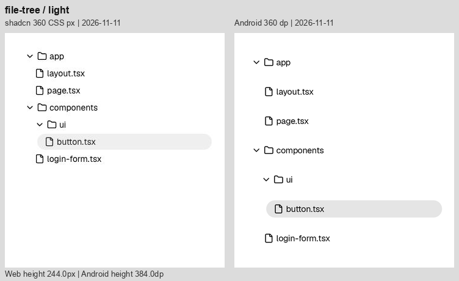
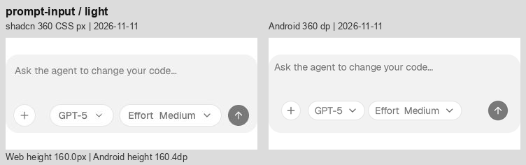
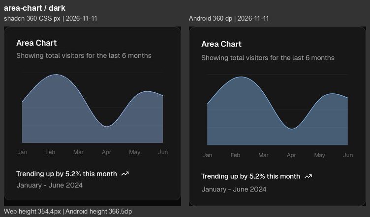

# Android 同宽视觉复查 · 2026-11-11

后续已进行组件修正，最新结果见 [视觉优化与复验](Android-Visual-Refinement-2026-11-11.md)。本文保留修正前状态。

分支 `codex/android-port`。本次重新采集并检查 **36 种组件、37 个样例状态、浅深色共 74 组对照（148 张原始截图）**。原站与 Android 均为 11 月 11 日的新截图，没有混用上轮网页存档。

**仍有明显视觉差异。** 最集中的问题是可展开列表的纵向密度，其次是消息代码区、登录卡片、输入区内部尺寸，以及图表的文字/留白。基础单控件、普通正文和表格已较接近，但不等于逐像素一致。

[打开逐项图库](Images/AndroidComparison-2026-11-11/index.html) · [尺寸与来源记录](../Reference/android-visual-metrics-2026-11-11.json) · [上一轮修正记录](Android-Visual-Comparison.md)

## 比较条件

- 两侧统一 **360 CSS px / 360 dp 的内容画布**，左为原站，右为 Android。保留自然高度，较短的一侧只在下方补背景，不拉伸内容。
- 原站在浏览器内实际渲染，文档页使用 1280×1200 桌面视口；仅约束示例容器宽度，不修改组件字体、颜色和内部间距。图表独立预览使用 360×1000 视口。Button 取 Default 示例，Input 取 Enter text 示例；两项仅临时调整示例容器位置以准确裁切。
- File Tree 保留原站 `max-w-xs` 的 **320 内宽**，与 Android 相同，并居中放入 360 画布。Input/Select/Progress 同样保留 **320/192/216** 的原例内宽。没有把固定宽度控件放大到 360。
- Button、Badge、Row、Input、Select、Switch、Progress、Separator 统一放在 **360×64** 画布中。表中的 64→64 仅表示画布高度，不能误解为可见控件高度。
- Android 为 API 35 / Android 15 模拟器，密度 2.625，默认字号；每项实际截取宽度 945 像素，缩放为 360。排除系统栏和画廊外边距。
- 样例文案、数据、展开状态一致。Reasoning 展开；Terminal 前两条折叠、构建输出展开；Confirmation 另取待审批态；Progress 等待 66% 稳定状态。
- 网页截图为浏览器返回的 JPEG，Android 为 PNG；输出转换到 sRGB。压缩、字体栅格化和亚像素边缘不适合用像素相似度打分；本报告基于逐图检查、实际高度和代码定位。颜色差别仅作视觉观察，不声称精确色值误差。
- 覆盖上述固定状态的浅深色外观；本次未覆盖所有下拉菜单、弹窗、悬停、加载过程与字体放大状态，也没有重新执行完整功能回归。

## 优先处理的差异

1. **展开列表的行高与间隔。** File Tree 高出 140，Queue 高出 152.8，Sources 高出 124.9，Stack Trace 高出 153.2。原生代码明确使用 48 dp 点击行；Queue 还叠加 8 dp 行间距。48 dp 是当前实现选择，不能把所有额外留白统称为安卓不可避免的差异。应先核对非点击留白，再决定是否增加紧凑视觉模式，同时避免点击范围相互重叠。
2. **消息工具栏与代码块。** 工具栏的 48 dp 布局槽把图标横向拉开；代码复制行把代码标题区撑高。行内代码目前是文字背景 span，缺少网页的独立内距与圆角。它们属于可单独处理的外观偏差。
3. **输入区内部尺寸。** Prompt Input 总高已经接近，但文字边距为 8 dp，圆钮和胶囊约 28 高；原站可见控件约 32。Chat 空态的位置和说明宽度也还没对齐。
4. **Card 与三种图表。** 登录卡片高出 65.5；三种图表均高出 12.1。前者主要来自表单/按钮布局，后者与标题、页脚文字行盒及间距有关，不能归因于 48 dp 点击区。
5. **局部字号、颜色和缩进。** Checkpoint 标题偏小；File Tree 文件夹左内距偏小、浅色选中底板偏深；Badge 浅红底偏淡；深色面积图填充仍有明显色调差别。Inline Citation 的徽标度量改变了第二段断行。

数字均按 360 宽下的 CSS px / dp 比较；下表总高来自网页元素实际矩形与 Android 截图元数据，不代表全部差值都应直接减去。

## 逐个组件

“显著 / 中 / 轻”描述截图中的视觉差异程度，不是功能缺陷严重级别。两种主题布局差异相同；主题专有问题在备注中列明。

| 组件 | 差异 | 样例总高：网页 → Android | 仍可见的差别 | 浅色 | 深色 |
| --- | --- | ---: | --- | --- | --- |
| [Chain of Thought](https://ui.shadcn.com/docs/ai-elements/base/chain-of-thought) | 中 | 288.0 → 297.5 | 折叠入口把后续回答下推约 28；总高只增加 9.5，是网页 288 最小高度吸收了部分差值，不能仅凭总高判断一致。 | [查看](Images/AndroidComparison-2026-11-11/chain-of-thought-light.png) | [查看](Images/AndroidComparison-2026-11-11/chain-of-thought-dark.png) |
| [Chat](https://ui.shadcn.com/docs/ai-elements/base/chat) | 中 | 800.0 → 800.0 | 800 总高一致，但空态图标/文案整体偏上约 12–16，标题说明间距更紧；输入区偏高，附件/发送圆底 28 对比原站 32，重置圆底也偏小。 | [查看](Images/AndroidComparison-2026-11-11/chat-light.png) | [查看](Images/AndroidComparison-2026-11-11/chat-dark.png) |
| [Checkpoint](https://ui.shadcn.com/docs/ai-elements/base/checkpoint) | 中 | 288.0 → 290.7 | “Button renamed” 使用 12 sp caption，原站显示更大的正文；中间分隔区更高，第二组消息下移约 24；Restore 文字颜色也较深。 | [查看](Images/AndroidComparison-2026-11-11/checkpoint-light.png) | [查看](Images/AndroidComparison-2026-11-11/checkpoint-dark.png) |
| [Confirmation 初始态](https://ui.shadcn.com/docs/ai-elements/base/confirmation) | 轻 | 288.0 → 288.0 | 按钮轮廓接近；同一个 288 高画布里，Android 可见按钮比原站约高 10，来自按钮外部的命中留白。 | [查看](Images/AndroidComparison-2026-11-11/confirmation-light.png) | [查看](Images/AndroidComparison-2026-11-11/confirmation-dark.png) |
| [Confirmation 待审批](https://ui.shadcn.com/docs/ai-elements/base/confirmation) | 中 | 288.0 → 332.2 | Thought 行和审批面板整体更松；面板内容分栏不同，Deny/Approve 向右，说明列更窄。总高增加 44.2。 | [查看](Images/AndroidComparison-2026-11-11/confirmation-approval-light.png) | [查看](Images/AndroidComparison-2026-11-11/confirmation-approval-dark.png) |
| [Context](https://ui.shadcn.com/docs/ai-elements/base/context) | 轻 | 124.0 → 144.0 | 8% 胶囊基本接近；总高 124→144，胶囊中心向下 10，来自 48 dp 命中区域。 | [查看](Images/AndroidComparison-2026-11-11/context-light.png) | [查看](Images/AndroidComparison-2026-11-11/context-dark.png) |
| [File Tree](https://ui.shadcn.com/docs/ai-elements/base/file-tree) | 显著 | 244.0 → 384.0 | 7 行每行 48 对比网页 28，总高增加 140；文件夹内左边距约少 4，第一层文件夹标题略偏左；浅色选中底板偏深。层级缩进与 320 内宽已对齐。 | [查看](Images/AndroidComparison-2026-11-11/file-tree-light.png) | [查看](Images/AndroidComparison-2026-11-11/file-tree-dark.png) |
| [Inline Citation](https://ui.shadcn.com/docs/ai-elements/base/inline-citation) | 中 | 374.0 → 369.5 | 引用徽标已参与换行，但第二段 Server Components 的断行位置不同，react.dev 被推到下一行；徽标内距/基线仍有细差，总高反而少 4.5。 | [查看](Images/AndroidComparison-2026-11-11/inline-citation-light.png) | [查看](Images/AndroidComparison-2026-11-11/inline-citation-dark.png) |
| [Message](https://ui.shadcn.com/docs/ai-elements/base/message) | 显著 | 434.2 → 463.6 | 工具栏图标中心间距明显更宽；代码标题区更高，行号/命令内容向右。行内代码缺少网页式的独立内距与圆角，字形占宽改变换行；总高增加 29.4。 | [查看](Images/AndroidComparison-2026-11-11/message-light.png) | [查看](Images/AndroidComparison-2026-11-11/message-dark.png) |
| [Model Selector](https://ui.shadcn.com/docs/ai-elements/base/model-selector) | 中 | 160.0 → 160.4 | 外框总高几乎一致；占位文字左/上内距更小，工具栏上移。模型与 Effort 胶囊为约 28 高，原站约 32；内部横向宽度也偏窄。 | [查看](Images/AndroidComparison-2026-11-11/model-selector-light.png) | [查看](Images/AndroidComparison-2026-11-11/model-selector-dark.png) |
| [Plan](https://ui.shadcn.com/docs/ai-elements/base/plan) | 中 | 367.5 → 409.1 | 展开标题增加纵向留白，步骤连接线下移；总高增加 41.6。静态步骤的行距已接近，标题前后与 Replay 周围还有额外空间。 | [查看](Images/AndroidComparison-2026-11-11/plan-light.png) | [查看](Images/AndroidComparison-2026-11-11/plan-dark.png) |
| [Prompt Input](https://ui.shadcn.com/docs/ai-elements/base/prompt-input) | 中 | 160.0 → 160.4 | 同 Model Selector：8 dp 外围内距使文字位置不同，28 dp 圆钮/胶囊偏小，底部控件整体偏上；不能用 160.0≈160.4 的总高认定内部一致。 | [查看](Images/AndroidComparison-2026-11-11/prompt-input-light.png) | [查看](Images/AndroidComparison-2026-11-11/prompt-input-dark.png) |
| [Queue](https://ui.shadcn.com/docs/ai-elements/base/queue) | 显著 | 344.8 → 497.5 | 4 个任务行被拉开，正文和 Replay 大幅下移，总高增加 152.8；48 dp 行高叠加每项 8 dp 间隔。 | [查看](Images/AndroidComparison-2026-11-11/queue-light.png) | [查看](Images/AndroidComparison-2026-11-11/queue-dark.png) |
| [Reasoning](https://ui.shadcn.com/docs/ai-elements/base/reasoning) | 中 | 417.2 → 438.9 | 标题入口下移，正文第一段更低；正文段落间距与网页不同，抵消了部分头部差值，回答起点反而接近。总高增加 21.6。 | [查看](Images/AndroidComparison-2026-11-11/reasoning-light.png) | [查看](Images/AndroidComparison-2026-11-11/reasoning-dark.png) |
| [Sources](https://ui.shadcn.com/docs/ai-elements/base/sources) | 显著 | 339.5 → 464.4 | 来源行距明显过松，3 条来源后面的 Replay 下移，总高增加 124.9；来源行左缩进略小。 | [查看](Images/AndroidComparison-2026-11-11/sources-light.png) | [查看](Images/AndroidComparison-2026-11-11/sources-dark.png) |
| [Stack Trace](https://ui.shadcn.com/docs/ai-elements/base/stack-trace) | 显著 | 384.8 → 537.9 | 标题、源码路径与 framework 入口更松，总高增加 153.2；错误正文左缩进偏小，红色更鲜；外层多出的持续竖线与网页视觉不同。 | [查看](Images/AndroidComparison-2026-11-11/stack-trace-light.png) | [查看](Images/AndroidComparison-2026-11-11/stack-trace-dark.png) |
| [Subagent](https://ui.shadcn.com/docs/ai-elements/base/subagent) | 显著 | 459.8 → 573.3 | 嵌套工具行间距更大，总高增加 113.6；长命令的可用宽度与省略位置不同，内层说明整体向下。 | [查看](Images/AndroidComparison-2026-11-11/subagent-light.png) | [查看](Images/AndroidComparison-2026-11-11/subagent-dark.png) |
| [Suggestion](https://ui.shadcn.com/docs/ai-elements/base/suggestion) | 中 | 196.0 → 224.4 | 建议条和输入区之间空隙更大，总高增加 28.4；右侧露出第三个建议的一部分，网页此位置有渐隐效果。输入控件尺寸同 Prompt Input。 | [查看](Images/AndroidComparison-2026-11-11/suggestion-light.png) | [查看](Images/AndroidComparison-2026-11-11/suggestion-dark.png) |
| [Task](https://ui.shadcn.com/docs/ai-elements/base/task) | 中 | 299.5 → 368.4 | 两组入口把回答向下推，末尾 Replay 继续增加留白，总高增加 68.9；正文中路径断行也不同。 | [查看](Images/AndroidComparison-2026-11-11/task-light.png) | [查看](Images/AndroidComparison-2026-11-11/task-dark.png) |
| [Terminal](https://ui.shadcn.com/docs/ai-elements/base/terminal) | 显著 | 532.8 → 613.3 | 三条命令入口增加纵向空间，总高增加 80.6；输出块左缩进略小，长命令/表格文本断行不同；网页底部有溢出渐隐，Android 为直接裁切/滚动。 | [查看](Images/AndroidComparison-2026-11-11/terminal-light.png) | [查看](Images/AndroidComparison-2026-11-11/terminal-dark.png) |
| [Test Results](https://ui.shadcn.com/docs/ai-elements/base/test-results) | 显著 | 502.2 → 615.6 | 嵌套入口与测试文件行更松，总高增加 113.4；错误块随层级略左移，堆栈路径换行位置不同。 | [查看](Images/AndroidComparison-2026-11-11/test-results-light.png) | [查看](Images/AndroidComparison-2026-11-11/test-results-dark.png) |
| [Tool](https://ui.shadcn.com/docs/ai-elements/base/tool) | 中 | 320.2 → 401.9 | 三条工具入口增高，错误输出块和结论下移，总高增加 81.7；输出块左边界比网页略靠左。 | [查看](Images/AndroidComparison-2026-11-11/tool-light.png) | [查看](Images/AndroidComparison-2026-11-11/tool-dark.png) |
| [Stack](https://ui.shadcn.com/docs/components/base/separator) | 轻 | 113.0 → 118.5 | 标题/说明的垂直度量累计使分隔线及正文下移约 5.5；字重和主要结构接近。 | [查看](Images/AndroidComparison-2026-11-11/stack-light.png) | [查看](Images/AndroidComparison-2026-11-11/stack-dark.png) |
| [Row](https://ui.shadcn.com/docs/components/base/badge) | 轻 | 64.0 → 64.0 | 四个徽标的总宽、单项边框与文字占宽有小差异；排列顺序与间距节奏一致。 | [查看](Images/AndroidComparison-2026-11-11/row-light.png) | [查看](Images/AndroidComparison-2026-11-11/row-dark.png) |
| [Card](https://ui.shadcn.com/docs/components/base/card) | 显著 | 357.0 → 422.5 | 422.5 对比 357，高出 65.5；Sign Up 更低，Password 行及页脚分隔线下移。输入框命中留白、Forgot 按钮行与页脚按钮间距共同放大高度。 | [查看](Images/AndroidComparison-2026-11-11/card-light.png) | [查看](Images/AndroidComparison-2026-11-11/card-dark.png) |
| [Text](https://ui.shadcn.com/docs/components/base/separator) | 轻 | 40.0 → 40.4 | 正文换行一致，总高仅多 0.4；剩余为字形栅格化和基线细差。 | [查看](Images/AndroidComparison-2026-11-11/text-light.png) | [查看](Images/AndroidComparison-2026-11-11/text-dark.png) |
| [Button](https://ui.shadcn.com/docs/components/base/button) | 轻 | 64.0 → 64.0 | 默认按钮可见高度约 32，宽度、圆角接近；文字基线和边缘有细差。64 是对照画布高，不是按钮高。 | [查看](Images/AndroidComparison-2026-11-11/button-light.png) | [查看](Images/AndroidComparison-2026-11-11/button-dark.png) |
| [Badge](https://ui.shadcn.com/docs/components/base/badge) | 轻 | 64.0 → 64.0 | 可见高度约 20；总宽略窄，浅色 Destructive 底色较淡。代码中浅色 alpha 为 .08，原站示例为 /10。 | [查看](Images/AndroidComparison-2026-11-11/badge-light.png) | [查看](Images/AndroidComparison-2026-11-11/badge-dark.png) |
| [Input](https://ui.shadcn.com/docs/components/base/input) | 轻 | 64.0 → 64.0 | 同为 320 内宽、约 32 可见高度；文字起点和边框抗锯齿略不同，深色填充/边框更明显。 | [查看](Images/AndroidComparison-2026-11-11/input-light.png) | [查看](Images/AndroidComparison-2026-11-11/input-dark.png) |
| [Select](https://ui.shadcn.com/docs/components/base/select) | 轻 | 64.0 → 64.0 | 192 内宽、32 外观高与单下箭头一致；主要剩余深色填充和文字/箭头基线细差。 | [查看](Images/AndroidComparison-2026-11-11/select-light.png) | [查看](Images/AndroidComparison-2026-11-11/select-dark.png) |
| [Switch](https://ui.shadcn.com/docs/components/base/switch) | 轻 | 64.0 → 64.0 | 32×18.4 轨道、白色滑块及标签距离基本接近；只见小幅文字占宽和边缘差异。 | [查看](Images/AndroidComparison-2026-11-11/switch-light.png) | [查看](Images/AndroidComparison-2026-11-11/switch-dark.png) |
| [Progress](https://ui.shadcn.com/docs/components/base/progress) | 轻 | 64.0 → 64.0 | 都停在 66%，216 宽、4 高一致；起点圆角与像素边缘仍有细差。 | [查看](Images/AndroidComparison-2026-11-11/progress-light.png) | [查看](Images/AndroidComparison-2026-11-11/progress-dark.png) |
| [Separator](https://ui.shadcn.com/docs/components/base/separator) | 轻 | 64.0 → 64.0 | 同为 360 宽、1 高；主要是像素取整/颜色合成导致的细线明暗差异。 | [查看](Images/AndroidComparison-2026-11-11/separator-light.png) | [查看](Images/AndroidComparison-2026-11-11/separator-dark.png) |
| [Table](https://ui.shadcn.com/docs/components/base/table) | 轻 | 371.5 → 374.9 | 四列、金额和合计均完整；Android 总高增加 3.4，行间分隔线逐渐偏下，Status/Method 列边界与网页有少量偏移。 | [查看](Images/AndroidComparison-2026-11-11/table-light.png) | [查看](Images/AndroidComparison-2026-11-11/table-dark.png) |
| [Bar Chart](https://ui.shadcn.com/view/new-york-v4/chart-bar-default) | 中 | 354.4 → 366.5 | 总高增加 12.1，绘图区与横轴整体下移约 5，页脚下移约 8；柱形数值比例接近，蓝色和细网格仍不同。 | [查看](Images/AndroidComparison-2026-11-11/bar-chart-light.png) | [查看](Images/AndroidComparison-2026-11-11/bar-chart-dark.png) |
| [Line Chart](https://ui.shadcn.com/view/new-york-v4/chart-line-default) | 中 | 354.4 → 366.5 | 自然曲线峰谷形状接近；绘图区和页脚偏下，总高增加 12.1；线色与抗锯齿不同。 | [查看](Images/AndroidComparison-2026-11-11/line-chart-light.png) | [查看](Images/AndroidComparison-2026-11-11/line-chart-dark.png) |
| [Area Chart](https://ui.shadcn.com/view/new-york-v4/chart-area-default) | 中 | 354.4 → 366.5 | 自然曲线形状接近，总高增加 12.1；深色面积填充明显更偏蓝灰/更暗，图表内网格与描边也有细差。 | [查看](Images/AndroidComparison-2026-11-11/area-chart-light.png) | [查看](Images/AndroidComparison-2026-11-11/area-chart-dark.png) |

## 代表性截图

文件树两侧内宽均为 320；主要差别是 28 与 48 的行高，另有文件夹内距和选中底色差别。

输入区外框高度接近，但可见控件大小与内边距尚未对齐。

深色面积图保留了曲线形状，仍能看到绘图区下移与填充色的差异。

## 代码定位与本轮验证

- 列表命中行高、嵌套间距、代码复制行：[Traces.kt](../Android/aielements/src/main/kotlin/dev/aielements/compose/Traces.kt)。
- File Tree 左内距与选中色、行内 Markdown/Citation：[Content.kt](../Android/aielements/src/main/kotlin/dev/aielements/compose/Content.kt)。
- 输入区 padding、消息工具栏、Chat 空态：[Chat.kt](../Android/aielements/src/main/kotlin/dev/aielements/compose/Chat.kt)。
- 28 dp 图标圆底、徽标透明度、Card 与图表卡片：[Primitives.kt](../Android/aielements/src/main/kotlin/dev/aielements/compose/Primitives.kt)。
- 字体与行盒：[Theme.kt](../Android/aielements/src/main/kotlin/dev/aielements/compose/Theme.kt)。

本轮只新增截图、对照图库与报告，未修改生产组件。当前分支原有改动保持原样。

`VisualAuditTest` 本次批量截图测试通过（1 个测试覆盖 74 个截图状态，25 秒）；74 对图片均检查浅深色，并复核 Button/Input 裁切及 File Tree 内宽。没有把截图测试表述为完整功能回归。

原始文件与采集日志位于本机 `.build/android-recheck-2026-11-11/`（`android/`、`web/`、`capture.log`、`compose.py`）；交付的 74 张对照 PNG、图库和测量 JSON 已放入仓库文档目录，查看不依赖临时文件。
