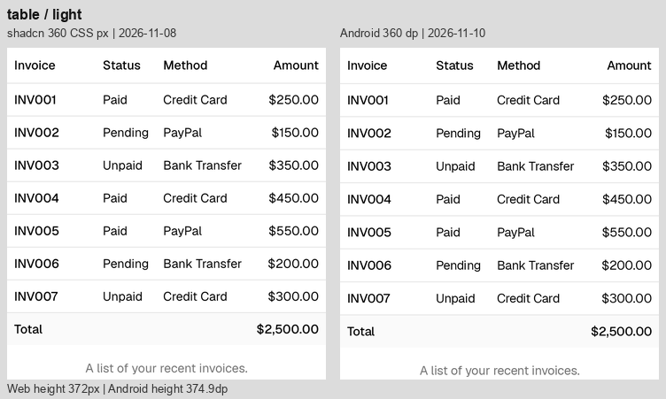
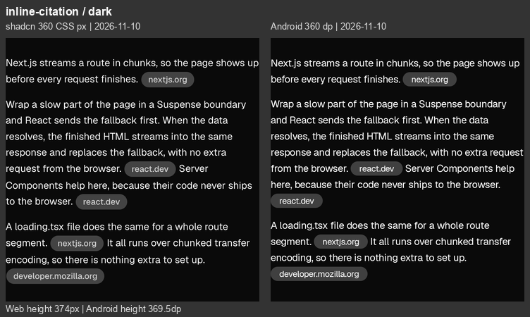
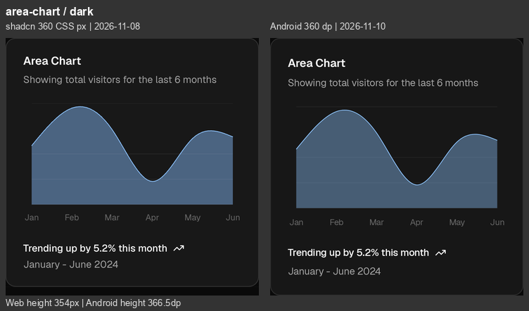

# Android 同宽视觉修正结果

> 最新复查：[2026-11-11 全量新截图与剩余差异](Android-Visual-Comparison-2026-11-11.md)。以下保留 11 月 10 日的修正记录。

2026-11-10 · 分支 `codex/android-port` · **36 种组件、37 个样例状态、74 张浅深色对照图**。

本轮已修改原生组件库，补齐上一轮审计中的主要结构与样式缺口：表格自适应列宽、行内引用、状态分组、输入区、卡片插槽、自然曲线和基础控件。每张图左侧为原站，右侧为修正后的 Android。

仍保留安卓的 48 dp 点击范围、原生菜单/对话框及系统返回行为。文件树、来源和任务等可点击列表因此比网页更高；字体栅格化、部分换行、细边框及色彩合成也仍不同。本报告不宣称逐像素一致。

## 采集来源与限制

- **Android 74 张全部在修正后重新采集。** Android 15 / API 35 ARM64 模拟器，密度 2.625，默认字号。原生 Compose 实际绘制，组件画布逐项断言为 360 dp，排除系统栏和画廊边距；最高样例 800 dp，未超出视窗。
- **原站沿用上一轮基准：18 张来自 2026-11-10，56 张为 2026-11-08 官方存档。** 本轮没有重新宣称在线抓取全部原站；每张图均标注原站日期。
- 11 月 10 日的 9 个组件为 Chain of Thought、Chat、Checkpoint、Confirmation 初始态、Context、File Tree、Inline Citation、Message、Tool。其余 AI 模式来自 [11 月 8 日存档](VisualComparison/2026-11-08-recheck/)，基础组件对应 [基础组件验收](Foundation-Visual-Validation.md)。
- 两侧统一到 **360 CSS px / 360 dp**，按密度等比例缩放并转换到 sRGB，不拉伸高度、不修饰组件。较矮一侧下方补背景色，图下注明各自高度。
- Input、Select、Progress 保留原例 320 / 192 / 216 的自身宽度。Button、Badge、Row、Input、Select、Switch、Progress、Separator 居中放在 360×64 画布中；画布高不等于控件外观高。
- 新截 AI 文档为桌面断点；旧 AI 截图为 390 CSS px 浏览器视口、360 内容宽。占位文字受网页断点影响，不能将该项直接作为字号精确一致的结论。
- Stack、Row、Text 分别对应 Separator 的竖排、Badge 的横排、Separator 的正文。完整 URL、来源路径和尺寸见 [测量记录](../Reference/android-visual-metrics.json)。

## 主要尺寸变化

以下仅用于说明布局恢复程度，不是相似度评分。点击区、字体度量及像素取整仍会影响总高。

| 样例（360 宽） | 修正前 Android | 修正后 Android | 原站 |
| --- | ---: | ---: | ---: |
| Table | 422.1 dp，金额列在视窗外 | 374.9 dp，四列完整显示 | 372 px |
| Inline Citation | 682.3 dp | 369.5 dp | 374 px |
| Prompt Input | 192.4 dp | 160.4 dp | 160 px |
| Area Chart | 464.4 dp | 366.5 dp | 354 px |

## 逐项修正

使用相同正文、命令、发票及图表数据，保持相同展开状态。表中“保留差异”是修正后仍可见的差别或平台取舍，并非尚未实现的占位说明。

| 组件 / 官方参照 | 已修正 | 保留差异 | 浅色 | 深色 |
| --- | --- | --- | --- | --- |
| [Chain Of Thought](https://ui.shadcn.com/docs/ai-elements/base/chain-of-thought) | 补上总摘要折叠入口与嵌套步骤。 | 折叠入口保留 48 dp 点击区。 | [查看](Images/AndroidComparison/chain-of-thought-light.png) | [查看](Images/AndroidComparison/chain-of-thought-dark.png) |
| [Chat](https://ui.shadcn.com/docs/ai-elements/base/chat) | 补齐空态图标、可配置文案、灰底输入区及蓝色发送圆钮。 | 重置/附件/发送使用 48 dp 点击区，空态中心略有偏移。 | [查看](Images/AndroidComparison/chat-light.png) | [查看](Images/AndroidComparison/chat-dark.png) |
| [Checkpoint](https://ui.shadcn.com/docs/ai-elements/base/checkpoint) | 说明与 Restore 独立排列，恢复细分隔线及紧凑按钮。 | Restore 的可见底板与点击区域分离。 | [查看](Images/AndroidComparison/checkpoint-light.png) | [查看](Images/AndroidComparison/checkpoint-dark.png) |
| [Confirmation](https://ui.shadcn.com/docs/ai-elements/base/confirmation) | 统一按钮字重、圆角、主色及点击反馈。 | 初始按钮的背景/基线仍有小差异。 | [查看](Images/AndroidComparison/confirmation-light.png) | [查看](Images/AndroidComparison/confirmation-dark.png) |
| [Confirmation Approval](https://ui.shadcn.com/docs/ai-elements/base/confirmation) | 恢复命令图标、说明、Deny/Approve 横排；窄屏或大字号改为纵排。 | 48 dp 按钮和推理折叠入口增加纵向留白。 | [查看](Images/AndroidComparison/confirmation-approval-light.png) | [查看](Images/AndroidComparison/confirmation-approval-dark.png) |
| [Context](https://ui.shadcn.com/docs/ai-elements/base/context) | 恢复居中的百分比胶囊入口，点开仍可查看 token 明细。 | 总高增加 20 dp 来容纳点击区。 | [查看](Images/AndroidComparison/context-light.png) | [查看](Images/AndroidComparison/context-dark.png) |
| [File Tree](https://ui.shadcn.com/docs/ai-elements/base/file-tree) | 恢复选中胶囊、前置箭头、文件/文件夹图标与层级缩进。 | 保留 48 dp 行高；网页为 28 px。 | [查看](Images/AndroidComparison/file-tree-light.png) | [查看](Images/AndroidComparison/file-tree-dark.png) |
| [Inline Citation](https://ui.shadcn.com/docs/ai-elements/base/inline-citation) | 改为真正参与正文换行的行内徽标，恢复域名与段落间距；可点开来源。 | 保留原生来源对话框；字体度量使少量换行/基线不同。 | [查看](Images/AndroidComparison/inline-citation-light.png) | [查看](Images/AndroidComparison/inline-citation-dark.png) |
| [Message](https://ui.shadcn.com/docs/ai-elements/base/message) | 用户操作右对齐，恢复工具栏顺序；代码支持行号及 Shell 基础着色。 | 工具栏与复制按钮保留 48 dp 点击区。 | [查看](Images/AndroidComparison/message-light.png) | [查看](Images/AndroidComparison/message-dark.png) |
| [Model Selector](https://ui.shadcn.com/docs/ai-elements/base/model-selector) | 恢复模型/推理强度胶囊、下拉箭头和输入区样式。 | 菜单仍使用 Android 弹出菜单；网页占位字号受存档断点影响。 | [查看](Images/AndroidComparison/model-selector-light.png) | [查看](Images/AndroidComparison/model-selector-dark.png) |
| [Plan](https://ui.shadcn.com/docs/ai-elements/base/plan) | 恢复路线图标、独立进度文字、前置折叠箭头与紧凑静态步骤。 | 标题折叠入口保留 48 dp 点击区。 | [查看](Images/AndroidComparison/plan-light.png) | [查看](Images/AndroidComparison/plan-dark.png) |
| [Prompt Input](https://ui.shadcn.com/docs/ai-elements/base/prompt-input) | 恢复灰底、附件/发送圆钮、胶囊工具栏，修正输入高度。 | 占位字号受网页断点影响，按 14 sp 原生正文保留。 | [查看](Images/AndroidComparison/prompt-input-light.png) | [查看](Images/AndroidComparison/prompt-input-dark.png) |
| [Queue](https://ui.shadcn.com/docs/ai-elements/base/queue) | 移除多余总标题，恢复 completed 计数与分组。 | 可点击任务行维持 48 dp，列表较高。 | [查看](Images/AndroidComparison/queue-light.png) | [查看](Images/AndroidComparison/queue-dark.png) |
| [Reasoning](https://ui.shadcn.com/docs/ai-elements/base/reasoning) | 统一标题图标规则、正文灰阶、段落节奏与展开状态。 | 折叠入口保留 48 dp；正文有字体度量细差。 | [查看](Images/AndroidComparison/reasoning-light.png) | [查看](Images/AndroidComparison/reasoning-dark.png) |
| [Sources](https://ui.shadcn.com/docs/ai-elements/base/sources) | 恢复 Used N sources、地球图标、外链箭头及默认展开。 | 来源链接维持 48 dp 点击区，列表较高。 | [查看](Images/AndroidComparison/sources-light.png) | [查看](Images/AndroidComparison/sources-dark.png) |
| [Stack Trace](https://ui.shadcn.com/docs/ai-elements/base/stack-trace) | 补上框架调用栈分组，恢复错误红字、源码路径与展开入口。 | 可点击源码行/框架入口维持 48 dp。 | [查看](Images/AndroidComparison/stack-trace-light.png) | [查看](Images/AndroidComparison/stack-trace-dark.png) |
| [Subagent](https://ui.shadcn.com/docs/ai-elements/base/subagent) | 恢复子代理摘要、嵌套工具、完成图标与灰色结论。 | 嵌套折叠入口维持 48 dp，面板较高。 | [查看](Images/AndroidComparison/subagent-light.png) | [查看](Images/AndroidComparison/subagent-dark.png) |
| [Suggestion](https://ui.shadcn.com/docs/ai-elements/base/suggestion) | 恢复胶囊外观、横向排列和输入区样式。 | 建议按钮维持 48 dp 点击区，整组稍高。 | [查看](Images/AndroidComparison/suggestion-light.png) | [查看](Images/AndroidComparison/suggestion-dark.png) |
| [Task](https://ui.shadcn.com/docs/ai-elements/base/task) | 恢复默认折叠、简洁标题，移除多余数量标签。 | 两组入口均维持 48 dp，整组较高。 | [查看](Images/AndroidComparison/task-light.png) | [查看](Images/AndroidComparison/task-dark.png) |
| [Terminal](https://ui.shadcn.com/docs/ai-elements/base/terminal) | 恢复 Ran 命令标题和折叠状态，输出去掉多余标题栏。 | 48 dp 入口及原生代码换行使面板较高；长输出可滚动。 | [查看](Images/AndroidComparison/terminal-light.png) | [查看](Images/AndroidComparison/terminal-dark.png) |
| [Test Results](https://ui.shadcn.com/docs/ai-elements/base/test-results) | 补上测试文件分组、数量/失败统计、默认展开失败项与错误输出。 | 可折叠的文件和失败用例仍保留 48 dp。 | [查看](Images/AndroidComparison/test-results-light.png) | [查看](Images/AndroidComparison/test-results-dark.png) |
| [Tool](https://ui.shadcn.com/docs/ai-elements/base/tool) | 恢复成功/失败标题、终端图标、红色错误文字和纯输出块。 | 可点击标题保留 48 dp。 | [查看](Images/AndroidComparison/tool-light.png) | [查看](Images/AndroidComparison/tool-dark.png) |
| [Stack](https://ui.shadcn.com/docs/components/base/separator) | 校准标签行高、正文与分隔线间距。 | 原生字体栅格化及像素取整细差。 | [查看](Images/AndroidComparison/stack-light.png) | [查看](Images/AndroidComparison/stack-dark.png) |
| [Row](https://ui.shadcn.com/docs/components/base/badge) | 复用修正后的 20 dp 徽章及浅红错误徽章。 | 原生文字基线细差。 | [查看](Images/AndroidComparison/row-light.png) | [查看](Images/AndroidComparison/row-dark.png) |
| [Card](https://ui.shadcn.com/docs/components/base/card) | 补上头部操作/独立页脚插槽，修正全宽按钮底板和深色层次。 | 表单操作和按钮维持 48 dp，示例卡片比网页高。 | [查看](Images/AndroidComparison/card-light.png) | [查看](Images/AndroidComparison/card-dark.png) |
| [Text](https://ui.shadcn.com/docs/components/base/separator) | 保持相同字号、行高、正文与换行。 | 原生字体栅格化及像素取整细差。 | [查看](Images/AndroidComparison/text-light.png) | [查看](Images/AndroidComparison/text-dark.png) |
| [Button](https://ui.shadcn.com/docs/components/base/button) | 修正紧凑外观、全宽底板、圆角和深色主色。 | 可见外观独立于 48 dp 点击区。 | [查看](Images/AndroidComparison/button-light.png) | [查看](Images/AndroidComparison/button-dark.png) |
| [Badge](https://ui.shadcn.com/docs/components/base/badge) | 恢复约 20 dp 高度、正确字重与浅红底红字。 | 原生字体度量和细边框取整差异。 | [查看](Images/AndroidComparison/badge-light.png) | [查看](Images/AndroidComparison/badge-dark.png) |
| [Input](https://ui.shadcn.com/docs/components/base/input) | 恢复 32 dp 可见边框、横向内距及深色输入底色。 | 独立 48 dp 编辑命中区保留。 | [查看](Images/AndroidComparison/input-light.png) | [查看](Images/AndroidComparison/input-dark.png) |
| [Select](https://ui.shadcn.com/docs/components/base/select) | 恢复 32 dp 外观、单下箭头及深色底色。 | 菜单与选择行为仍为 Android 原生，点击区 48 dp。 | [查看](Images/AndroidComparison/select-light.png) | [查看](Images/AndroidComparison/select-dark.png) |
| [Switch](https://ui.shadcn.com/docs/components/base/switch) | 恢复 32×18.4 dp 轨道、白色滑块、标签间距及开关语义。 | 整行保留 48 dp 点击区；未使用网页事件实现。 | [查看](Images/AndroidComparison/switch-light.png) | [查看](Images/AndroidComparison/switch-dark.png) |
| [Progress](https://ui.shadcn.com/docs/components/base/progress) | 移除进度段间的 Material 间隙，统一 4 dp 轨道和深色填充。 | 亚像素边缘与端点取整细差。 | [查看](Images/AndroidComparison/progress-light.png) | [查看](Images/AndroidComparison/progress-dark.png) |
| [Separator](https://ui.shadcn.com/docs/components/base/separator) | 维持 1 dp 细线与主题边框色。 | 亚像素/抗锯齿细差。 | [查看](Images/AndroidComparison/separator-light.png) | [查看](Images/AndroidComparison/separator-dark.png) |
| [Table](https://ui.shadcn.com/docs/components/base/table) | 按内容测量列宽并分配可用空间，360 dp 可完整显示四列和合计。 | 更窄容器或大字号仍允许横向滚动，避免截断金额。 | [查看](Images/AndroidComparison/table-light.png) | [查看](Images/AndroidComparison/table-dark.png) |
| [Bar Chart](https://ui.shadcn.com/view/new-york-v4/chart-bar-default) | 统一纵轴范围、绘图区比例、柱宽/圆角、卡片底色与标题/页脚。 | 保留长按/辅助操作查看数据；原生文字行盒使卡片约 367 dp，对照约 354 px。 | [查看](Images/AndroidComparison/bar-chart-light.png) | [查看](Images/AndroidComparison/bar-chart-dark.png) |
| [Line Chart](https://ui.shadcn.com/view/new-york-v4/chart-line-default) | 改为自然三次样条，修正端点、纵轴范围、绘图区与卡片层次。 | 原生文字行盒使卡片约高 12 dp；Canvas 抗锯齿仍不同。 | [查看](Images/AndroidComparison/line-chart-light.png) | [查看](Images/AndroidComparison/line-chart-dark.png) |
| [Area Chart](https://ui.shadcn.com/view/new-york-v4/chart-area-default) | 采用自然曲线、40% 填充与 1 dp 描边，修正纵轴范围和卡片层次。 | 原生文字行盒使卡片约高 12 dp；色彩合成仍有细差，尤其深色填充。 | [查看](Images/AndroidComparison/area-chart-light.png) | [查看](Images/AndroidComparison/area-chart-dark.png) |

## 代表性结果

表格四列与合计现在可在同一个 360 dp 画布中完整显示。



引用徽标参与正文换行，恢复连续段落，同时仍可打开来源详情。



面积图已采用自然曲线、匹配的坐标范围、40% 填充和深色卡片；仍能看到原生与浏览器的细微色彩合成差别。



## 验证与复现

验证结果及横屏、大字号、平板覆盖见 [Android 验证记录](Android-Validation.md)。截图用语义操作对齐展开状态，等待布局与动画稳定；未用跨字体渲染器的“相似度百分比”替代逐图检查。

- [对齐样例](../Android/aielements/src/androidTest/kotlin/dev/aielements/compose/VisualAuditFixtures.kt)
- [截图测试](../Android/aielements/src/androidTest/kotlin/dev/aielements/compose/VisualAuditTest.kt)
- [新增交互回归](../Android/aielements/src/androidTest/kotlin/dev/aielements/compose/VisualParityInteractionTest.kt)
- [自然曲线与轴域测试](../Android/aielements/src/test/kotlin/dev/aielements/compose/ChartGeometryTest.kt)

使用本机 Android SDK、JDK 17 和已启动模拟器，在仓库根目录运行：

```sh
Android/gradlew -p Android :aielements:connectedDebugAndroidTest \
  -Pandroid.testInstrumentationRunnerArguments.visualAudit=true
adb pull /sdcard/Download/AIElementsAudit/. .build/android-visual-audit/android/
```

常规测试默认跳过批量截图，只有 `visualAudit=true` 才执行。原始 Android 截图、尺寸及语义树保留于本机 `.build/android-visual-audit/android/`；新网页原图在 `.build/android-visual-audit/web/`，合成脚本在 `.build/android-visual-audit/compose.py`。本报告的 74 张对照图均已保存，不依赖本机临时目录即可查看。
