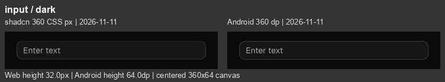
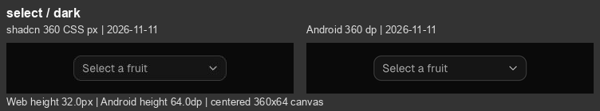

# Android 第四轮精修与同宽对照 · 2026-11-11

在 `codex/android-port` 修正公共表单组件后，重新采集并逐项检查 **36 种组件、37 个状态、浅深色 74 组对照**。原站与 Android 两侧均为本轮新截图。

[逐项图库](Images/AndroidFidelity-2026-11-11/index.html) · [尺寸与来源](../Reference/android-visual-fidelity-2026-11-11.json) · [上一轮](Android-Visual-Precision-2026-11-11.md)

## 本轮修正

- 深色输入框与选择框：原站 `dark:bg-input/30` 将 15% 白色再乘 30%，实际透明度为 **4.5%**。Android 原为 6%，已按实际样式修正，内嵌表单同步生效。
- 输入框：文字左起点由 10 调整为 11 dp，包含 CSS 盒模型中的 1 px 边框。
- 选择框：内容左内距 11、右内距 9 dp，文字与箭头间隔 6 dp；匹配原站边框加左右 10/8 px 内距的结果。
- 所有修改落在公共组件和主题中，未修改截图样例。保留独立 48 dp 编辑与点击区域；没有压缩列表点击行或移动命中区域。

## 基准与采集修正

- 对照画布统一 **360 CSS px / 360 dp**。File Tree 内宽 320；Input / Select / Progress 分别为 320 / 192 / 216。小控件居中放在 360×64 画布，64 不是组件自身高度。
- 原站全部重新截图：主题及目标内容稳定后采集，排除主题过渡帧；图表等待完整路径，进度条保留最终 66%。历史元数据曾记录到 Select 约 0.77% 的过渡透明度，本轮最终值稳定为 4.5%。
- 长页面截图使用文档坐标：初次检查发现 Input / Button / Chat 的滚动后裁切坐标偏移，已补拍替换，并检查最终图中组件完整。
- 原站仅临时调整预览宽度、主题和视口，未改组件文案及布局规则；已恢复并关闭临时页面。
- 错误色通过实际 CSS Lab 与浏览器画布转换核对：浅色 RGB 231/0/11，深色 255/100/103；图表主色 142/197/255，与 Android 值一致。本轮没有按截图观感改写这些颜色。网页 JPEG 与原生 PNG 在色彩、抗锯齿及字体栅格化上仍有差异，未计算虚假的“像素一致率”。
- Android API 35、默认字号、2.625 倍密度，截图原宽 945 px。所有对照的自然高度与上一轮保持一致。Android 仅 6/74 张截图发生变化（card-light, card-dark, input-light, input-dark, select-light, select-dark），其余字节一致。

## 逐项剩余差异

“明显 / 中 / 轻”表示视觉差异程度，不是功能严重等级。

| 组件 | 差异 | 原站 / Android 高度 | 当前差异 | 浅色 | 深色 |
| --- | --- | ---: | --- | --- | --- |
| [Chain of Thought](https://ui.shadcn.com/docs/ai-elements/base/chain-of-thought) | 中 | 288.0 / 297.5 | 展开入口及回答仍偏下；总高仅多 9.5，不能掩盖正文起点约 28 的位移。主要关联 48 dp 展开行。 | [查看](Images/AndroidFidelity-2026-11-11/chain-of-thought-light.png) | [查看](Images/AndroidFidelity-2026-11-11/chain-of-thought-dark.png) |
| [Chat](https://ui.shadcn.com/docs/ai-elements/base/chat) | 轻 | 800.0 / 800.0 | 重置按钮的可见圆面向上、向右各对齐 8 dp，独立 48 dp 点击区保持不变；标题、说明和空态已接近。仍有细微字体基线、说明占宽及输入框位置差异。 | [查看](Images/AndroidFidelity-2026-11-11/chat-light.png) | [查看](Images/AndroidFidelity-2026-11-11/chat-dark.png) |
| [Checkpoint](https://ui.shadcn.com/docs/ai-elements/base/checkpoint) | 中 | 288.0 / 290.7 | Restore 已改为弱化色、中等字重；分隔区仍较高，第二组消息下移。 | [查看](Images/AndroidFidelity-2026-11-11/checkpoint-light.png) | [查看](Images/AndroidFidelity-2026-11-11/checkpoint-dark.png) |
| [Confirmation 初始态](https://ui.shadcn.com/docs/ai-elements/base/confirmation) | 轻 | 288.0 / 288.0 | 可见按钮在 288 高画布内仍约高 10；按钮自身的形状接近。 | [查看](Images/AndroidFidelity-2026-11-11/confirmation-light.png) | [查看](Images/AndroidFidelity-2026-11-11/confirmation-dark.png) |
| [Confirmation 待审批](https://ui.shadcn.com/docs/ai-elements/base/confirmation) | 中 | 288.0 / 327.6 | Deny/Approve 已在面板内垂直居中；两侧说明均为两行，上轮“多换一行”的判断不成立。Thought 和 Reset 的点击范围仍使面板及总高度偏下。 | [查看](Images/AndroidFidelity-2026-11-11/confirmation-approval-light.png) | [查看](Images/AndroidFidelity-2026-11-11/confirmation-approval-dark.png) |
| [Context](https://ui.shadcn.com/docs/ai-elements/base/context) | 轻 | 124.0 / 144.0 | 胶囊外观接近；独立 48 dp 点击范围使画布增高 20，中心向下偏 10。 | [查看](Images/AndroidFidelity-2026-11-11/context-light.png) | [查看](Images/AndroidFidelity-2026-11-11/context-dark.png) |
| [File Tree](https://ui.shadcn.com/docs/ai-elements/base/file-tree) | 明显 | 244.0 / 384.0 | 7 个可点击行均为 48，网页为 28，累计高出 140；缩进和浅色选中底色已改善。保留触控尺寸时，这一密度差仍会存在。 | [查看](Images/AndroidFidelity-2026-11-11/file-tree-light.png) | [查看](Images/AndroidFidelity-2026-11-11/file-tree-dark.png) |
| [Inline Citation](https://ui.shadcn.com/docs/ai-elements/base/inline-citation) | 轻 | 374.0 / 369.5 | 主要断行已接近；徽标占位、圆底宽度和文本基线仍有细差，最后一段总高度略少。 | [查看](Images/AndroidFidelity-2026-11-11/inline-citation-light.png) | [查看](Images/AndroidFidelity-2026-11-11/inline-citation-dark.png) |
| [Message](https://ui.shadcn.com/docs/ai-elements/base/message) | 中 | 434.2 / 459.8 | 行号右移 4，行号至代码的间距由 16 缩至 12，命令起点保持不变。原站与 Android 命令横向起点已接近；主要差异仍为操作图标 48 对比 28 的中心间距、消息纵向位置和细微字体基线。 | [查看](Images/AndroidFidelity-2026-11-11/message-light.png) | [查看](Images/AndroidFidelity-2026-11-11/message-dark.png) |
| [Model Selector](https://ui.shadcn.com/docs/ai-elements/base/model-selector) | 轻 | 160.0 / 160.4 | 32 高的模型/Effort 胶囊、文字边距与外框已接近；横向位置、文字基线和深色边框仍有小差别。 | [查看](Images/AndroidFidelity-2026-11-11/model-selector-light.png) | [查看](Images/AndroidFidelity-2026-11-11/model-selector-dark.png) |
| [Plan](https://ui.shadcn.com/docs/ai-elements/base/plan) | 中 | 367.5 / 409.1 | 静态步骤间距接近；可展开标题较高，使步骤连接线、回答与 Replay 整体下移。 | [查看](Images/AndroidFidelity-2026-11-11/plan-light.png) | [查看](Images/AndroidFidelity-2026-11-11/plan-dark.png) |
| [Prompt Input](https://ui.shadcn.com/docs/ai-elements/base/prompt-input) | 轻 | 160.0 / 160.4 | 整体尺寸与内部可见控件已接近，仍有少量控件横向偏移、占位文字基线和边框差异。 | [查看](Images/AndroidFidelity-2026-11-11/prompt-input-light.png) | [查看](Images/AndroidFidelity-2026-11-11/prompt-input-dark.png) |
| [Queue](https://ui.shadcn.com/docs/ai-elements/base/queue) | 明显 | 344.8 / 473.5 | 4 个任务行仍比网页高 20 左右；去除额外行间距后，回答及 Replay 仍明显下移。 | [查看](Images/AndroidFidelity-2026-11-11/queue-light.png) | [查看](Images/AndroidFidelity-2026-11-11/queue-dark.png) |
| [Reasoning](https://ui.shadcn.com/docs/ai-elements/base/reasoning) | 中 | 417.2 / 459.0 | 正文恢复 22.75 行高，并以一个空行的高度分段，随字号缩放。第一段仍受 48 dp 展开入口影响而偏下；总高增大是恢复文字节奏后的真实结果，没有再压缩行距抵消入口高度。 | [查看](Images/AndroidFidelity-2026-11-11/reasoning-light.png) | [查看](Images/AndroidFidelity-2026-11-11/reasoning-dark.png) |
| [Sources](https://ui.shadcn.com/docs/ai-elements/base/sources) | 明显 | 339.5 / 448.4 | 三条来源行仍使用独立 48 dp 区域，Replay 明显下移；文本起点与层级线大体接近，剩余细差以字体基线为主。 | [查看](Images/AndroidFidelity-2026-11-11/sources-light.png) | [查看](Images/AndroidFidelity-2026-11-11/sources-dark.png) |
| [Stack Trace](https://ui.shadcn.com/docs/ai-elements/base/stack-trace) | 明显 | 384.8 / 513.9 | 源码行和框架入口仍更松，错误正文与回答下移。已核对原站实际 CSS Lab 及浏览器 sRGB 转换，错误色与 Android 色值一致；截图红色饱和度仍有差别，未根据压缩图任意改色。 | [查看](Images/AndroidFidelity-2026-11-11/stack-trace-light.png) | [查看](Images/AndroidFidelity-2026-11-11/stack-trace-dark.png) |
| [Subagent](https://ui.shadcn.com/docs/ai-elements/base/subagent) | 明显 | 459.8 / 557.3 | 内层正文已继承展开区域的 22.75 行高。工具入口仍逐项增高，说明和回答下移；长命令省略位置仍不同。 | [查看](Images/AndroidFidelity-2026-11-11/subagent-light.png) | [查看](Images/AndroidFidelity-2026-11-11/subagent-dark.png) |
| [Suggestion](https://ui.shadcn.com/docs/ai-elements/base/suggestion) | 中 | 196.0 / 224.4 | 渐隐效果已存在，但 48 dp 建议行加外部间隔使输入框比网页低约 28；第三条建议的露出范围也不同。 | [查看](Images/AndroidFidelity-2026-11-11/suggestion-light.png) | [查看](Images/AndroidFidelity-2026-11-11/suggestion-dark.png) |
| [Task](https://ui.shadcn.com/docs/ai-elements/base/task) | 中 | 299.5 / 368.4 | 两个工具入口使后续回答和 Replay 下移；正文路径的折行位置也不同。 | [查看](Images/AndroidFidelity-2026-11-11/task-light.png) | [查看](Images/AndroidFidelity-2026-11-11/task-dark.png) |
| [Terminal](https://ui.shadcn.com/docs/ai-elements/base/terminal) | 明显 | 532.8 / 613.3 | 三个命令入口使输出块下移；长命令/表格断行不同。底部渐隐与圆角已补齐，当前差别不能归为缺失渐隐。 | [查看](Images/AndroidFidelity-2026-11-11/terminal-light.png) | [查看](Images/AndroidFidelity-2026-11-11/terminal-dark.png) |
| [Test Results](https://ui.shadcn.com/docs/ai-elements/base/test-results) | 明显 | 502.2 / 599.6 | 测试文件与失败项入口逐层增高，错误块和结论下移；堆栈路径的换行位置不同。 | [查看](Images/AndroidFidelity-2026-11-11/test-results-light.png) | [查看](Images/AndroidFidelity-2026-11-11/test-results-dark.png) |
| [Tool](https://ui.shadcn.com/docs/ai-elements/base/tool) | 明显 | 320.2 / 401.9 | 三条工具入口比网页高，错误输出和结论随之下移；代码字形、内距有细差。 | [查看](Images/AndroidFidelity-2026-11-11/tool-light.png) | [查看](Images/AndroidFidelity-2026-11-11/tool-dark.png) |
| [Stack](https://ui.shadcn.com/docs/components/base/separator) | 轻 | 113.0 / 113.9 | 高度差已缩到约 0.9，剩余是标题/分隔线基线和边缘细差。 | [查看](Images/AndroidFidelity-2026-11-11/stack-light.png) | [查看](Images/AndroidFidelity-2026-11-11/stack-dark.png) |
| [Row](https://ui.shadcn.com/docs/components/base/badge) | 轻 | 64.0 / 64.0（画布） | 四个徽标排列已接近；单项字形占宽、边框与底色仍有小差别。 | [查看](Images/AndroidFidelity-2026-11-11/row-light.png) | [查看](Images/AndroidFidelity-2026-11-11/row-dark.png) |
| [Card](https://ui.shadcn.com/docs/components/base/card) | 中 | 357.0 / 378.3 | 内嵌输入框与描边按钮的深色填充随公共颜色修正，字段文字起点也已调整。密码框、页脚和按钮间距仍更高，主要关联独立 48 dp 编辑及点击区域，总高仍多约 21.3。 | [查看](Images/AndroidFidelity-2026-11-11/card-light.png) | [查看](Images/AndroidFidelity-2026-11-11/card-dark.png) |
| [Text](https://ui.shadcn.com/docs/components/base/separator) | 轻 | 40.0 / 40.4 | 正文换行一致，高度只多约 0.4；主要是字形栅格化细差。 | [查看](Images/AndroidFidelity-2026-11-11/text-light.png) | [查看](Images/AndroidFidelity-2026-11-11/text-dark.png) |
| [Button](https://ui.shadcn.com/docs/components/base/button) | 轻 | 64.0 / 64.0（画布） | 原站主题过渡完成后重拍，深色主按钮已是正确的浅色底；两侧形状和颜色接近，仍有宽度、文字基线与边缘细差。64 为对照画布高度。 | [查看](Images/AndroidFidelity-2026-11-11/button-light.png) | [查看](Images/AndroidFidelity-2026-11-11/button-dark.png) |
| [Badge](https://ui.shadcn.com/docs/components/base/badge) | 轻 | 64.0 / 64.0（画布） | 浅色错误底色已修正；标签宽度、文字和圆角边缘仍有细差。 | [查看](Images/AndroidFidelity-2026-11-11/badge-light.png) | [查看](Images/AndroidFidelity-2026-11-11/badge-dark.png) |
| [Input](https://ui.shadcn.com/docs/components/base/input) | 轻 | 64.0 / 64.0（画布） | 深色填充从 6% 修正为原站的 4.5%，文字起点计入 1 dp 边框，320 内宽、32 可见高度不变。剩余为边框抗锯齿、文字基线和微小字形差异。 | [查看](Images/AndroidFidelity-2026-11-11/input-light.png) | [查看](Images/AndroidFidelity-2026-11-11/input-dark.png) |
| [Select](https://ui.shadcn.com/docs/components/base/select) | 轻 | 64.0 / 64.0（画布） | 深色填充改为 4.5%；内容左内距 11、箭头右内距 9，显式保留文字和图标间 6 的空隙，192 内宽、32 可见高度不变。字形、箭头笔触及边框仍有细差。 | [查看](Images/AndroidFidelity-2026-11-11/select-light.png) | [查看](Images/AndroidFidelity-2026-11-11/select-dark.png) |
| [Switch](https://ui.shadcn.com/docs/components/base/switch) | 轻 | 64.0 / 64.0（画布） | 轨道尺寸、滑块和标签关系接近；边缘与字形占宽略不同。 | [查看](Images/AndroidFidelity-2026-11-11/switch-light.png) | [查看](Images/AndroidFidelity-2026-11-11/switch-dark.png) |
| [Progress](https://ui.shadcn.com/docs/components/base/progress) | 轻 | 64.0 / 64.0（画布） | 216 宽、4 高、66% 进度一致；起点圆角与像素边缘略不同。 | [查看](Images/AndroidFidelity-2026-11-11/progress-light.png) | [查看](Images/AndroidFidelity-2026-11-11/progress-dark.png) |
| [Separator](https://ui.shadcn.com/docs/components/base/separator) | 轻 | 64.0 / 64.0（画布） | 360 宽、1 高一致；细线明暗与像素取整略不同。 | [查看](Images/AndroidFidelity-2026-11-11/separator-light.png) | [查看](Images/AndroidFidelity-2026-11-11/separator-dark.png) |
| [Table](https://ui.shadcn.com/docs/components/base/table) | 轻 | 371.5 / 371.4 | 分隔线改为行内绘制，消除逐行像素取整累积；按实际字重测量并分配列宽。总高 371.43 对比 371.50，差约 -0.07；列边界、文本基线与线条明暗仍有细差。 | [查看](Images/AndroidFidelity-2026-11-11/table-light.png) | [查看](Images/AndroidFidelity-2026-11-11/table-dark.png) |
| [Bar Chart](https://ui.shadcn.com/view/new-york-v4/chart-bar-default) | 轻 | 354.4 / 354.7 | 高度差仅约 0.3，标题/页脚对齐明显改善；柱色、网格线和边缘仍不同。 | [查看](Images/AndroidFidelity-2026-11-11/bar-chart-light.png) | [查看](Images/AndroidFidelity-2026-11-11/bar-chart-dark.png) |
| [Line Chart](https://ui.shadcn.com/view/new-york-v4/chart-line-default) | 轻 | 354.4 / 354.7 | 自然曲线形状、布局已接近；描边颜色、细网格与抗锯齿仍不同，高度差约 0.3。 | [查看](Images/AndroidFidelity-2026-11-11/line-chart-light.png) | [查看](Images/AndroidFidelity-2026-11-11/line-chart-dark.png) |
| [Area Chart](https://ui.shadcn.com/view/new-york-v4/chart-area-default) | 中 | 354.4 / 354.7 | 自然曲线及高度接近（高差约 0.3）；面积透明度 0.4 与颜色转换已核对。稳定主题截图仍有填充色、网格和边缘渲染差别，未凭压缩截图改写色值。 | [查看](Images/AndroidFidelity-2026-11-11/area-chart-light.png) | [查看](Images/AndroidFidelity-2026-11-11/area-chart-dark.png) |

## 验证

- 调试 APK、发布 AAR、测试 APK 构建通过，Lint 无错误。
- 设备回归 **23/23 通过**，覆盖 74 状态截图、输入与选择菜单、独立触控区域、大字号表格、重置回调、审批重试等。
- 完成 27 张原生整屏检查：Input / Select 及图库 Report 卡片，覆盖手机横竖屏、1.3 倍字号和平板横竖屏。登录卡片由 360 dp 对照样例覆盖；图库 Report 卡片是不同内容。所有前台检查通过，没有遮挡截图入库。
- 本轮没有新增真机或最低系统版本验证；未改协议、图表几何及相关单元测试。

仍然最明显的是 File Tree（+140）、Queue（约 +129）、Stack Trace（约 +129）和 Sources（约 +109）的点击行密度，以及 Message 操作栏 48 对比 28 的图标间距。Card 仍高约 21.3，代码路径换行、文字基线与细线渲染也有差异。**本轮完成表单细节修正，并未达到像素级一致。**

[来源及构建指纹](../Reference/android-visual-fidelity-evidence-2026-11-11.json)。原始截图及日志位于 `.build/android-polish4-2026-11-11/`。
