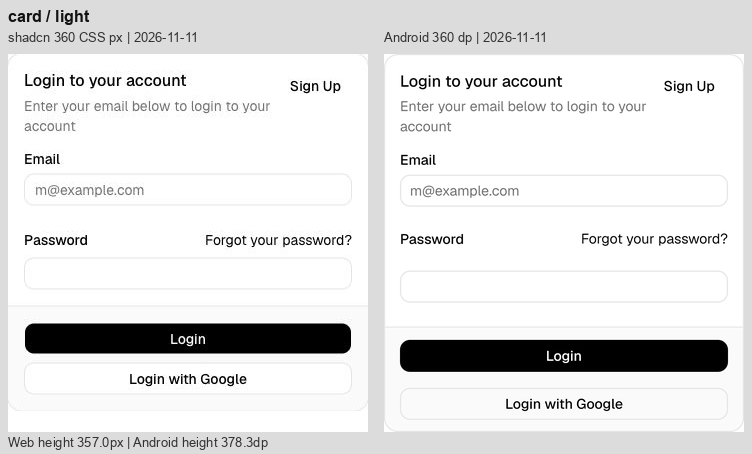
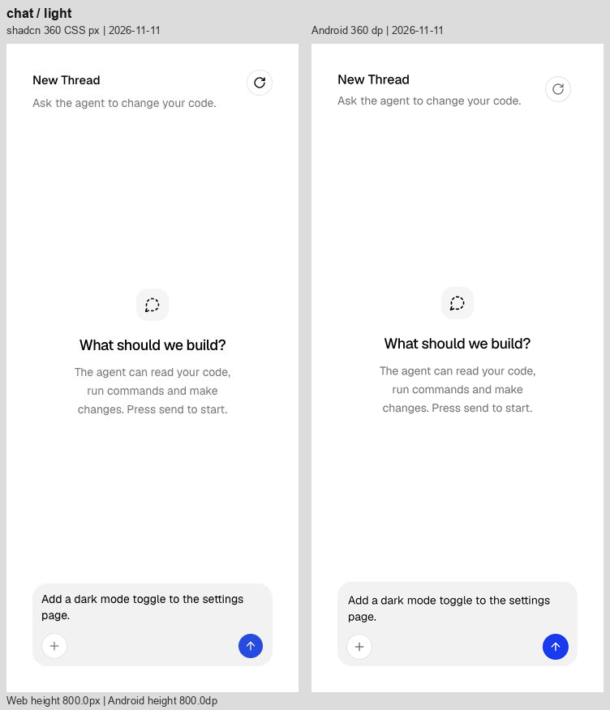

# Android 第二轮优化与同宽比较 · 2026-11-11

在 `codex/android-port` 修正真实 Compose 组件后，重新采集 **36 种组件、37 个状态、浅深色共 74 张 Android 截图**，与当天保存的完整原站截图逐个对照。

[完整逐项图库](Images/AndroidPolish-2026-11-11/index.html) · [尺寸及来源](../Reference/android-visual-polish-2026-11-11.json) · [上一轮结果](Android-Visual-Remaining-2026-11-11.md)

## 本轮修正

- Card 以“页眉 / 正文 / 页脚”为间距单位，不再给正文的每个字段重复加 16；页脚纵向留白减少 8。JSON 卡片通过显式 Stack 保持原有正文间距，图表布局不受影响。
- 增加公开的链接式按钮外观，Forgot 文本贴齐字段右边界，保留独立 48 dp 点击区。
- 增加 `AIChatHeader`，由图库和对照样例共同使用，真实图库接入清空会话回调；窄矮横屏不放入此页眉。修正空态图标至标题的重复间距、标题字距与行距、说明行距。
- Trace 内正文继承 22.75 行高，推理段落间空行随系统字号缩放；不通过压紧文字掩盖较高的展开入口。
- 代码行号宽度增加 4、与代码的间距减少 4，代码起点保持稳定。Restore 改为弱化色、中等字重。审批操作在面板中垂直居中；内容较窄（外宽不足 352 dp）或大字号时，操作移至说明下方，避免说明挤成窄列。
- 截图脚本现在检查前台窗口，系统弹窗遮挡时会停止并恢复设备设置，避免交付无效截图。
- 对照样例仅改为调用真实 `AIChatHeader` 和链接式按钮 API；未添加截图专用字体、偏移、颜色或负间距。

## 比较口径

- 统一 360 CSS px / 360 dp，左原站、右 Android，保留自然高度。File Tree 内宽 320；Input / Select / Progress 内宽 320 / 192 / 216。八个小控件居中放入 360×64 画布，64 不是控件可见高度。
- Android 15 / API 35，密度 2.625、默认字号，截图实际宽 945 px。恢复设备连接失败后启用同规格的独立测试模拟器，没有改变对照尺寸。
- 文案、数据、展开状态相同。网页参考为 11 月 11 日完整 74 张截图；本轮浏览器工具不可用，**没有重新采集网页**。原站可能在参考采集之后变化，本报告只对保存的版本负责。
- 图片转为 sRGB 后并排，网页 JPEG 与原生 PNG 的压缩、栅格化差异不适合用像素相似度分数判断。深色面积图色差仍保留记录，未凭截图反推并修改色值。
- 纠正上轮两项观察：待审批说明在两侧都是两行；Message 命令的横向起点本已接近，主要需校准的是行号间隔和消息工具栏。

## 修正前后

高度单位按 CSS px / dp 比较，仅描述几何尺寸，不作为唯一验收指标。

| 状态 | 原站 | 修正前 Android | 当前 Android | 当前高度差 |
| --- | ---: | ---: | ---: | ---: |
| card | 357.0 | 401.9 | 378.3 | +21.3 |
| chat | 800.0 | 800.0 | 800.0 | +0.0 |
| reasoning | 417.2 | 438.9 | 459.0 | +41.8 |
| subagent | 459.8 | 549.3 | 557.3 | +97.6 |
| message | 434.2 | 459.8 | 459.8 | +25.6 |
| confirmation-approval | 288.0 | 327.6 | 327.6 | +39.6 |
| bar-chart | 354.4 | 354.7 | 354.7 | +0.3 |
| line-chart | 354.4 | 354.7 | 354.7 | +0.3 |
| area-chart | 354.4 | 354.7 | 354.7 | +0.3 |

## 逐项剩余差异

明显 / 中 / 轻表示视觉差别，不是功能严重等级。

| 组件 | 差异 | 原站 / Android 高度 | 当前差异 | 浅色 | 深色 |
| --- | --- | ---: | --- | --- | --- |
| [Chain of Thought](https://ui.shadcn.com/docs/ai-elements/base/chain-of-thought) | 中 | 288.0 / 297.5 | 展开入口及回答仍偏下；总高仅多 9.5，不能掩盖正文起点约 28 的位移。主要关联 48 dp 展开行。 | [查看](Images/AndroidPolish-2026-11-11/chain-of-thought-light.png) | [查看](Images/AndroidPolish-2026-11-11/chain-of-thought-dark.png) |
| [Chat](https://ui.shadcn.com/docs/ai-elements/base/chat) | 轻 | 800.0 / 800.0 | 标题/说明间距、空态标题字距和行距已修正；空态整体更接近原站。重置按钮仍因独立 48 dp 区域而偏下，说明宽度与基线仍有细差。 | [查看](Images/AndroidPolish-2026-11-11/chat-light.png) | [查看](Images/AndroidPolish-2026-11-11/chat-dark.png) |
| [Checkpoint](https://ui.shadcn.com/docs/ai-elements/base/checkpoint) | 中 | 288.0 / 290.7 | Restore 已改为弱化色、中等字重；分隔区仍较高，第二组消息下移。 | [查看](Images/AndroidPolish-2026-11-11/checkpoint-light.png) | [查看](Images/AndroidPolish-2026-11-11/checkpoint-dark.png) |
| [Confirmation 初始态](https://ui.shadcn.com/docs/ai-elements/base/confirmation) | 轻 | 288.0 / 288.0 | 可见按钮在 288 高画布内仍约高 10；按钮自身的形状接近。 | [查看](Images/AndroidPolish-2026-11-11/confirmation-light.png) | [查看](Images/AndroidPolish-2026-11-11/confirmation-dark.png) |
| [Confirmation 待审批](https://ui.shadcn.com/docs/ai-elements/base/confirmation) | 中 | 288.0 / 327.6 | Deny/Approve 已在面板内垂直居中；两侧说明均为两行，上轮“多换一行”的判断不成立。Thought 和 Reset 的点击范围仍使面板及总高度偏下。 | [查看](Images/AndroidPolish-2026-11-11/confirmation-approval-light.png) | [查看](Images/AndroidPolish-2026-11-11/confirmation-approval-dark.png) |
| [Context](https://ui.shadcn.com/docs/ai-elements/base/context) | 轻 | 124.0 / 144.0 | 胶囊外观接近；独立 48 dp 点击范围使画布增高 20，中心向下偏 10。 | [查看](Images/AndroidPolish-2026-11-11/context-light.png) | [查看](Images/AndroidPolish-2026-11-11/context-dark.png) |
| [File Tree](https://ui.shadcn.com/docs/ai-elements/base/file-tree) | 明显 | 244.0 / 384.0 | 7 个可点击行均为 48，网页为 28，累计高出 140；缩进和浅色选中底色已改善。保留触控尺寸时，这一密度差仍会存在。 | [查看](Images/AndroidPolish-2026-11-11/file-tree-light.png) | [查看](Images/AndroidPolish-2026-11-11/file-tree-dark.png) |
| [Inline Citation](https://ui.shadcn.com/docs/ai-elements/base/inline-citation) | 轻 | 374.0 / 369.5 | 主要断行已接近；徽标占位、圆底宽度和文本基线仍有细差，最后一段总高度略少。 | [查看](Images/AndroidPolish-2026-11-11/inline-citation-light.png) | [查看](Images/AndroidPolish-2026-11-11/inline-citation-dark.png) |
| [Message](https://ui.shadcn.com/docs/ai-elements/base/message) | 中 | 434.2 / 459.8 | 行号右移 4，行号至代码的间距由 16 缩至 12，命令起点保持不变。原站与 Android 命令横向起点已接近；主要差异仍为操作图标 48 对比 28 的中心间距、消息纵向位置和细微字体基线。 | [查看](Images/AndroidPolish-2026-11-11/message-light.png) | [查看](Images/AndroidPolish-2026-11-11/message-dark.png) |
| [Model Selector](https://ui.shadcn.com/docs/ai-elements/base/model-selector) | 轻 | 160.0 / 160.4 | 32 高的模型/Effort 胶囊、文字边距与外框已接近；横向位置、文字基线和深色边框仍有小差别。 | [查看](Images/AndroidPolish-2026-11-11/model-selector-light.png) | [查看](Images/AndroidPolish-2026-11-11/model-selector-dark.png) |
| [Plan](https://ui.shadcn.com/docs/ai-elements/base/plan) | 中 | 367.5 / 409.1 | 静态步骤间距接近；可展开标题较高，使步骤连接线、回答与 Replay 整体下移。 | [查看](Images/AndroidPolish-2026-11-11/plan-light.png) | [查看](Images/AndroidPolish-2026-11-11/plan-dark.png) |
| [Prompt Input](https://ui.shadcn.com/docs/ai-elements/base/prompt-input) | 轻 | 160.0 / 160.4 | 整体尺寸与内部可见控件已接近，仍有少量控件横向偏移、占位文字基线和边框差异。 | [查看](Images/AndroidPolish-2026-11-11/prompt-input-light.png) | [查看](Images/AndroidPolish-2026-11-11/prompt-input-dark.png) |
| [Queue](https://ui.shadcn.com/docs/ai-elements/base/queue) | 明显 | 344.8 / 473.5 | 4 个任务行仍比网页高 20 左右；去除额外行间距后，回答及 Replay 仍明显下移。 | [查看](Images/AndroidPolish-2026-11-11/queue-light.png) | [查看](Images/AndroidPolish-2026-11-11/queue-dark.png) |
| [Reasoning](https://ui.shadcn.com/docs/ai-elements/base/reasoning) | 中 | 417.2 / 459.0 | 正文恢复 22.75 行高，并以一个空行的高度分段，随字号缩放。第一段仍受 48 dp 展开入口影响而偏下；总高增大是恢复文字节奏后的真实结果，没有再压缩行距抵消入口高度。 | [查看](Images/AndroidPolish-2026-11-11/reasoning-light.png) | [查看](Images/AndroidPolish-2026-11-11/reasoning-dark.png) |
| [Sources](https://ui.shadcn.com/docs/ai-elements/base/sources) | 明显 | 339.5 / 448.4 | 三条来源行仍使用独立 48 dp 区域，Replay 明显下移；文本起点与层级线大体接近，剩余细差以字体基线为主。 | [查看](Images/AndroidPolish-2026-11-11/sources-light.png) | [查看](Images/AndroidPolish-2026-11-11/sources-dark.png) |
| [Stack Trace](https://ui.shadcn.com/docs/ai-elements/base/stack-trace) | 明显 | 384.8 / 513.9 | 源码行和框架入口仍更松；错误正文与后续回答下移，红色较鲜。两侧均有层级竖线，不能将竖线本身误判为多余。 | [查看](Images/AndroidPolish-2026-11-11/stack-trace-light.png) | [查看](Images/AndroidPolish-2026-11-11/stack-trace-dark.png) |
| [Subagent](https://ui.shadcn.com/docs/ai-elements/base/subagent) | 明显 | 459.8 / 557.3 | 内层正文已继承展开区域的 22.75 行高。工具入口仍逐项增高，说明和回答下移；长命令省略位置仍不同。 | [查看](Images/AndroidPolish-2026-11-11/subagent-light.png) | [查看](Images/AndroidPolish-2026-11-11/subagent-dark.png) |
| [Suggestion](https://ui.shadcn.com/docs/ai-elements/base/suggestion) | 中 | 196.0 / 224.4 | 渐隐效果已存在，但 48 dp 建议行加外部间隔使输入框比网页低约 28；第三条建议的露出范围也不同。 | [查看](Images/AndroidPolish-2026-11-11/suggestion-light.png) | [查看](Images/AndroidPolish-2026-11-11/suggestion-dark.png) |
| [Task](https://ui.shadcn.com/docs/ai-elements/base/task) | 中 | 299.5 / 368.4 | 两个工具入口使后续回答和 Replay 下移；正文路径的折行位置也不同。 | [查看](Images/AndroidPolish-2026-11-11/task-light.png) | [查看](Images/AndroidPolish-2026-11-11/task-dark.png) |
| [Terminal](https://ui.shadcn.com/docs/ai-elements/base/terminal) | 明显 | 532.8 / 613.3 | 三个命令入口使输出块下移；长命令/表格断行不同。底部渐隐与圆角已补齐，当前差别不能归为缺失渐隐。 | [查看](Images/AndroidPolish-2026-11-11/terminal-light.png) | [查看](Images/AndroidPolish-2026-11-11/terminal-dark.png) |
| [Test Results](https://ui.shadcn.com/docs/ai-elements/base/test-results) | 明显 | 502.2 / 599.6 | 测试文件与失败项入口逐层增高，错误块和结论下移；堆栈路径的换行位置不同。 | [查看](Images/AndroidPolish-2026-11-11/test-results-light.png) | [查看](Images/AndroidPolish-2026-11-11/test-results-dark.png) |
| [Tool](https://ui.shadcn.com/docs/ai-elements/base/tool) | 明显 | 320.2 / 401.9 | 三条工具入口比网页高，错误输出和结论随之下移；代码字形、内距有细差。 | [查看](Images/AndroidPolish-2026-11-11/tool-light.png) | [查看](Images/AndroidPolish-2026-11-11/tool-dark.png) |
| [Stack](https://ui.shadcn.com/docs/components/base/separator) | 轻 | 113.0 / 113.9 | 高度差已缩到约 0.9，剩余是标题/分隔线基线和边缘细差。 | [查看](Images/AndroidPolish-2026-11-11/stack-light.png) | [查看](Images/AndroidPolish-2026-11-11/stack-dark.png) |
| [Row](https://ui.shadcn.com/docs/components/base/badge) | 轻 | 64.0 / 64.0（画布） | 四个徽标排列已接近；单项字形占宽、边框与底色仍有小差别。 | [查看](Images/AndroidPolish-2026-11-11/row-light.png) | [查看](Images/AndroidPolish-2026-11-11/row-dark.png) |
| [Card](https://ui.shadcn.com/docs/components/base/card) | 中 | 357.0 / 378.3 | 去掉卡片正文的重复 16 间距和页脚多余 8 留白；Forgot 文本已贴齐字段右边界。密码框和页脚仍较原站偏下，按钮间的视觉间隔较宽，关联独立 48 dp 编辑/点击行。 | [查看](Images/AndroidPolish-2026-11-11/card-light.png) | [查看](Images/AndroidPolish-2026-11-11/card-dark.png) |
| [Text](https://ui.shadcn.com/docs/components/base/separator) | 轻 | 40.0 / 40.4 | 正文换行一致，高度只多约 0.4；主要是字形栅格化细差。 | [查看](Images/AndroidPolish-2026-11-11/text-light.png) | [查看](Images/AndroidPolish-2026-11-11/text-dark.png) |
| [Button](https://ui.shadcn.com/docs/components/base/button) | 轻 | 64.0 / 64.0（画布） | 可见高度约 32，形状接近；宽度、文字基线和边缘有细差。64 为对照画布高度。 | [查看](Images/AndroidPolish-2026-11-11/button-light.png) | [查看](Images/AndroidPolish-2026-11-11/button-dark.png) |
| [Badge](https://ui.shadcn.com/docs/components/base/badge) | 轻 | 64.0 / 64.0（画布） | 浅色错误底色已修正；标签宽度、文字和圆角边缘仍有细差。 | [查看](Images/AndroidPolish-2026-11-11/badge-light.png) | [查看](Images/AndroidPolish-2026-11-11/badge-dark.png) |
| [Input](https://ui.shadcn.com/docs/components/base/input) | 轻 | 64.0 / 64.0（画布） | 320 内宽、32 可见高度接近；深色填充和边框更明显，文字起点略不同。 | [查看](Images/AndroidPolish-2026-11-11/input-light.png) | [查看](Images/AndroidPolish-2026-11-11/input-dark.png) |
| [Select](https://ui.shadcn.com/docs/components/base/select) | 轻 | 64.0 / 64.0（画布） | 192 内宽、32 可见高度接近；文字/箭头基线、深色边框与填充仍有细差。 | [查看](Images/AndroidPolish-2026-11-11/select-light.png) | [查看](Images/AndroidPolish-2026-11-11/select-dark.png) |
| [Switch](https://ui.shadcn.com/docs/components/base/switch) | 轻 | 64.0 / 64.0（画布） | 轨道尺寸、滑块和标签关系接近；边缘与字形占宽略不同。 | [查看](Images/AndroidPolish-2026-11-11/switch-light.png) | [查看](Images/AndroidPolish-2026-11-11/switch-dark.png) |
| [Progress](https://ui.shadcn.com/docs/components/base/progress) | 轻 | 64.0 / 64.0（画布） | 216 宽、4 高、66% 进度一致；起点圆角与像素边缘略不同。 | [查看](Images/AndroidPolish-2026-11-11/progress-light.png) | [查看](Images/AndroidPolish-2026-11-11/progress-dark.png) |
| [Separator](https://ui.shadcn.com/docs/components/base/separator) | 轻 | 64.0 / 64.0（画布） | 360 宽、1 高一致；细线明暗与像素取整略不同。 | [查看](Images/AndroidPolish-2026-11-11/separator-light.png) | [查看](Images/AndroidPolish-2026-11-11/separator-dark.png) |
| [Table](https://ui.shadcn.com/docs/components/base/table) | 轻 | 371.5 / 374.9 | 四列与金额完整；行分隔线逐渐偏下，总高多约 3.4，Status/Method 列边界有小偏移。 | [查看](Images/AndroidPolish-2026-11-11/table-light.png) | [查看](Images/AndroidPolish-2026-11-11/table-dark.png) |
| [Bar Chart](https://ui.shadcn.com/view/new-york-v4/chart-bar-default) | 轻 | 354.4 / 354.7 | 高度差仅约 0.3，标题/页脚对齐明显改善；柱色、网格线和边缘仍不同。 | [查看](Images/AndroidPolish-2026-11-11/bar-chart-light.png) | [查看](Images/AndroidPolish-2026-11-11/bar-chart-dark.png) |
| [Line Chart](https://ui.shadcn.com/view/new-york-v4/chart-line-default) | 轻 | 354.4 / 354.7 | 自然曲线形状、布局已接近；描边颜色、细网格与抗锯齿仍不同，高度差约 0.3。 | [查看](Images/AndroidPolish-2026-11-11/line-chart-light.png) | [查看](Images/AndroidPolish-2026-11-11/line-chart-dark.png) |
| [Area Chart](https://ui.shadcn.com/view/new-york-v4/chart-area-default) | 中 | 354.4 / 354.7 | 高度差仅约 0.3；深色面积填充仍偏蓝灰且略暗，网格/描边略不同。截图色差不足以单独证明代码色值错误。 | [查看](Images/AndroidPolish-2026-11-11/area-chart-light.png) | [查看](Images/AndroidPolish-2026-11-11/area-chart-dark.png) |

## 验证及边界

- 调试 APK / 发布 AAR 构建成功；Lint 为 **0 错误、13 警告**。警告仍是既有依赖更新提示与可选 Modifier 参数位置。
- 先完成 21 项设备回归；窄屏审批调整后，专项运行 3 项（新增窄屏布局/审批操作、既有失败重试、74 状态截图），累计 **22 个不同用例通过**。新增检查还覆盖 1.3 倍字号卡片各输入/按钮区域分离，以及页眉描述换行后重置按钮仍可点击。
- 3 项图表几何单元测试通过。协议层没有改动，本轮未重跑协议测试。
- 33 张原生图库视口截图完成，覆盖受影响页面的手机浅深色、1.3 倍字号、手机横屏、平板横竖屏；随后从最后构建刷新 3 张审批界面和 6 张等待生成完成的仪表板。
- 最后源码重新采集的 74 张组件截图与已审阅图片 74/74 字节一致。先前被系统弹窗遮挡的整屏图已作废，未用于报告。
- 当前验证为 API 35 模拟器；未声称覆盖真机、API 26、全部读屏路径或每个中间系统版本。

本轮人工逐项查看全部 74 组对照，同时检查受影响的手机/平板、横竖屏、大字号原生界面。结论：卡片和空态的布局改善，原有组件仍可操作；**尚未达到像素级一致**。文件树、任务队列、来源和堆栈等列表的 48 dp 独立点击行，以及消息工具栏，是仍然最显著的差异。不会用重叠点击区或拉伸截图消除它们。

原始截图、测试日志及修正前源码保存在 `.build/android-polish2-2026-11-11/`。提交到文档中的图片均为真实原生截图或与原站的并排合成；来源和文件指纹见 [证据记录](../Reference/android-visual-polish-evidence-2026-11-11.json)。本轮没有运行仅适用于网页结构的检测器，没有对未实际验证的性能或读屏流程评分。
