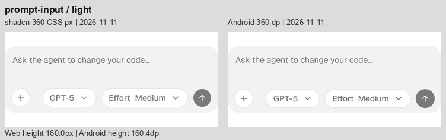
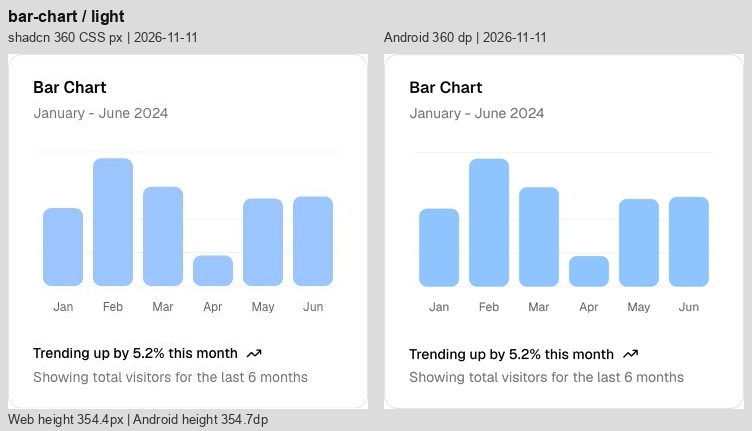

# Android 视觉优化与复验 · 2026-11-11

修正后的最新逐项审查见 [当前剩余视觉差异](Android-Visual-Remaining-2026-11-11.md)。

本轮在 `codex/android-port` 修改实际 Compose 组件，修复上一轮同宽对比中的输入控件尺寸、标签行盒、代码样式、列表重复间隔及局部颜色/缩进问题。**不是逐像素一致声明**：交互行保留独立 48 dp 点击区域，字体渲染、部分换行与面积图颜色合成仍有差别。

[逐项浅深色图库](Images/AndroidRefinement-2026-11-11/index.html) · [修正前审查](Android-Visual-Comparison-2026-11-11.md) · [新测量记录](../Reference/android-visual-refinement-2026-11-11.json) · [验证记录](Android-Validation.md)

## 本轮修正

- **输入区**：附件、发送、重置与模型菜单可见高度统一到 32；调整内边距、模型间距及对齐。保留点击范围，大字号时菜单换行。
- **字体与图表**：移除紧凑标签多出的首尾行留白，使用精细字形宽度测量。三种图表总高由 366.5 降到 354.7，原站为 354.4；Stack 由 118.5 降到 113.9，原站为 113。
- **列表与卡片**：Queue、Sources、Subagent、Stack Trace、Test Results 去掉重复行间距；卡片修正页眉操作对齐并缩减页脚留白。列表行仍为独立 48 dp，不以重叠点击区换取网页密度。
- **内容细节**：行内代码增加圆角/内距并保留长文本换行；引用徽标调整字重、宽度和占位高度；Checkpoint 使用 14 sp；文件树修正缩进和选中底色；错误徽标浅色底改为 10% 透明度。
- **溢出与线条**：建议条和终端输出增加随真实滚动状态变化的渐隐，输出区域按圆角裁切；保留与原站对应的层级竖线。

## 比较条件与证据

36 种组件、37 个样例状态、浅深色 **74 组对照**。左为 11 月 11 日采集的原站，右为本轮修正后的 Android。沿用同日原站截图，重新采集全部 Android 状态；不改示例数据、文案和展开状态来制造相似结果。

两侧均为 360 CSS px / 360 dp 画布；File Tree 保留 320 内宽，Input/Select/Progress 保留 320/192/216 内宽。Button、Badge、Row、Input、Select、Switch、Progress、Separator 的 64 是居中比较画布高度，**不是控件高度**。Android 为 API 35 模拟器，密度 2.625，默认字号。网页 JPEG 与 Android PNG 均转为 sRGB；图片不拉伸，只在较短一侧补背景。完整采集条件见修正前报告。

下表高度为默认字号下的示例自然高度，不能将所有差值都归为可删除的留白。原站截图有压缩及色彩管理差别，本轮采用目视检查和几何尺寸，不用像素相似度评分。

## 逐个组件的结果

| 组件 | Android 修正前 → 后 | 原站 | 本轮结果及保留差异 | 浅色 | 深色 |
| --- | ---: | ---: | --- | --- | --- |
| [Chain of Thought](https://ui.shadcn.com/docs/ai-elements/base/chain-of-thought) | 297.5 → 297.5 | 288.0 | 保持原有结构；48 dp 展开入口仍把正文下推，网页最小高度吸收了部分总高差值。 | [查看](Images/AndroidRefinement-2026-11-11/chain-of-thought-light.png) | [查看](Images/AndroidRefinement-2026-11-11/chain-of-thought-dark.png) |
| [Chat](https://ui.shadcn.com/docs/ai-elements/base/chat) | 800.0 → 800.0 | 800.0 | 附件、发送、重置圆底改为 32；压缩输入区多余内距。空态仍略偏上，标题说明间距仍有细差。 | [查看](Images/AndroidRefinement-2026-11-11/chat-light.png) | [查看](Images/AndroidRefinement-2026-11-11/chat-dark.png) |
| [Checkpoint](https://ui.shadcn.com/docs/ai-elements/base/checkpoint) | 290.7 → 290.7 | 288.0 | 状态文字从 12 sp 调到 14 sp。Restore 保留独立触控范围，中间分隔区和第二组消息仍比网页更低。 | [查看](Images/AndroidRefinement-2026-11-11/checkpoint-light.png) | [查看](Images/AndroidRefinement-2026-11-11/checkpoint-dark.png) |
| [Confirmation 初始态](https://ui.shadcn.com/docs/ai-elements/base/confirmation) | 288.0 → 288.0 | 288.0 | 按钮外观接近；48 dp 命中范围使可见按钮在画布内的位置仍略不同。 | [查看](Images/AndroidRefinement-2026-11-11/confirmation-light.png) | [查看](Images/AndroidRefinement-2026-11-11/confirmation-dark.png) |
| [Confirmation 待审批](https://ui.shadcn.com/docs/ai-elements/base/confirmation) | 332.2 → 327.6 | 288.0 | 标签字形与行盒已统一。说明列仍较窄，审批按钮与展开入口保留原生触控尺寸；未声称此面板已对齐。 | [查看](Images/AndroidRefinement-2026-11-11/confirmation-approval-light.png) | [查看](Images/AndroidRefinement-2026-11-11/confirmation-approval-dark.png) |
| [Context](https://ui.shadcn.com/docs/ai-elements/base/context) | 144.0 → 144.0 | 124.0 | 胶囊外观接近；48 dp 命中范围导致示例高出 20。 | [查看](Images/AndroidRefinement-2026-11-11/context-light.png) | [查看](Images/AndroidRefinement-2026-11-11/context-dark.png) |
| [File Tree](https://ui.shadcn.com/docs/ai-elements/base/file-tree) | 384.0 → 384.0 | 244.0 | 修正文件夹左内距和浅色选中底色；内宽保持 320。7 个可点击行仍为 48，网页为 28，因此总高仍多 140。 | [查看](Images/AndroidRefinement-2026-11-11/file-tree-light.png) | [查看](Images/AndroidRefinement-2026-11-11/file-tree-dark.png) |
| [Inline Citation](https://ui.shadcn.com/docs/ai-elements/base/inline-citation) | 369.5 → 369.5 | 374.0 | 修正徽标字重、内距、24 高占位和底色；第二段 Server Components 与 react.dev 的换行现已接近原站。仍有基线与总高细差。 | [查看](Images/AndroidRefinement-2026-11-11/inline-citation-light.png) | [查看](Images/AndroidRefinement-2026-11-11/inline-citation-dark.png) |
| [Message](https://ui.shadcn.com/docs/ai-elements/base/message) | 463.6 → 459.8 | 434.2 | 行内代码增加独立圆角和内距，按正文 90% 字号显示；长代码可换行并保留可读文本。减少代码正文上方留白，工具栏和复制按钮仍占 48 dp。 | [查看](Images/AndroidRefinement-2026-11-11/message-light.png) | [查看](Images/AndroidRefinement-2026-11-11/message-dark.png) |
| [Model Selector](https://ui.shadcn.com/docs/ai-elements/base/model-selector) | 160.4 → 160.4 | 160.0 | 模型与 Effort 胶囊、附件/发送圆底改为 32；调整文字边距、胶囊间距和右对齐。大字号下可换行且点击区不重叠。 | [查看](Images/AndroidRefinement-2026-11-11/model-selector-light.png) | [查看](Images/AndroidRefinement-2026-11-11/model-selector-dark.png) |
| [Plan](https://ui.shadcn.com/docs/ai-elements/base/plan) | 409.1 → 409.1 | 367.5 | 保持步骤层级与静态行间距；展开标题和 Replay 仍保留原生触控留白。 | [查看](Images/AndroidRefinement-2026-11-11/plan-light.png) | [查看](Images/AndroidRefinement-2026-11-11/plan-dark.png) |
| [Prompt Input](https://ui.shadcn.com/docs/ai-elements/base/prompt-input) | 160.4 → 160.4 | 160.0 | 修正文字内距、32 高控件、工具栏位置与胶囊间距；整体 160.4 对比网页 160。 | [查看](Images/AndroidRefinement-2026-11-11/prompt-input-light.png) | [查看](Images/AndroidRefinement-2026-11-11/prompt-input-dark.png) |
| [Queue](https://ui.shadcn.com/docs/ai-elements/base/queue) | 497.5 → 473.5 | 344.8 | 去掉 4 个点击行之间重复的 8 dp 间隔，共减少 24；每行仍有独立 48 dp 命中区，边界点击测试通过。 | [查看](Images/AndroidRefinement-2026-11-11/queue-light.png) | [查看](Images/AndroidRefinement-2026-11-11/queue-dark.png) |
| [Reasoning](https://ui.shadcn.com/docs/ai-elements/base/reasoning) | 438.9 → 438.9 | 417.2 | 正文、标题与结构保持；段落行距和入口留白仍不同，不能只看总高判断一致。 | [查看](Images/AndroidRefinement-2026-11-11/reasoning-light.png) | [查看](Images/AndroidRefinement-2026-11-11/reasoning-dark.png) |
| [Sources](https://ui.shadcn.com/docs/ai-elements/base/sources) | 464.4 → 448.4 | 339.5 | 去掉来源行间重复间隔，共减少 16；内容左缩进调为 24；行对齐仍有细差，可点击行仍高于原站。 | [查看](Images/AndroidRefinement-2026-11-11/sources-light.png) | [查看](Images/AndroidRefinement-2026-11-11/sources-dark.png) |
| [Stack Trace](https://ui.shadcn.com/docs/ai-elements/base/stack-trace) | 537.9 → 513.9 | 384.8 | 去掉多余行间距，修正内容缩进，共减少 24；源码与框架入口仍保留 48 dp，红色及文本基线有细差。 | [查看](Images/AndroidRefinement-2026-11-11/stack-trace-light.png) | [查看](Images/AndroidRefinement-2026-11-11/stack-trace-dark.png) |
| [Subagent](https://ui.shadcn.com/docs/ai-elements/base/subagent) | 573.3 → 549.3 | 459.8 | 去掉嵌套工具行额外间隔，共减少 24；保留层级线及 48 dp 入口，长命令省略位置仍有差别。 | [查看](Images/AndroidRefinement-2026-11-11/subagent-light.png) | [查看](Images/AndroidRefinement-2026-11-11/subagent-dark.png) |
| [Suggestion](https://ui.shadcn.com/docs/ai-elements/base/suggestion) | 224.4 → 224.4 | 196.0 | 加入随横向溢出状态变化的边缘渐隐，并应用新版输入区。建议点击行仍为 48，故输入区位置比网页低。 | [查看](Images/AndroidRefinement-2026-11-11/suggestion-light.png) | [查看](Images/AndroidRefinement-2026-11-11/suggestion-dark.png) |
| [Task](https://ui.shadcn.com/docs/ai-elements/base/task) | 368.4 → 368.4 | 299.5 | 保持嵌套入口行为；48 dp 入口使总高和回答起点仍不同，路径断行仍有细差。 | [查看](Images/AndroidRefinement-2026-11-11/task-light.png) | [查看](Images/AndroidRefinement-2026-11-11/task-dark.png) |
| [Terminal](https://ui.shadcn.com/docs/ai-elements/base/terminal) | 613.3 → 613.3 | 532.8 | 补上底部溢出渐隐及圆角裁切，调整内容缩进；内容保持可滚动。命令入口高度与部分代码换行仍不同。 | [查看](Images/AndroidRefinement-2026-11-11/terminal-light.png) | [查看](Images/AndroidRefinement-2026-11-11/terminal-dark.png) |
| [Test Results](https://ui.shadcn.com/docs/ai-elements/base/test-results) | 615.6 → 599.6 | 502.2 | 去掉测试文件层重复间隔，共减少 16；保留嵌套层级线及可点击失败项，堆栈长行换行仍不同。 | [查看](Images/AndroidRefinement-2026-11-11/test-results-light.png) | [查看](Images/AndroidRefinement-2026-11-11/test-results-dark.png) |
| [Tool](https://ui.shadcn.com/docs/ai-elements/base/tool) | 401.9 → 401.9 | 320.2 | 修正输出块缩进和圆角裁切；三个工具入口仍采用 48 dp。 | [查看](Images/AndroidRefinement-2026-11-11/tool-light.png) | [查看](Images/AndroidRefinement-2026-11-11/tool-dark.png) |
| [Stack](https://ui.shadcn.com/docs/components/base/separator) | 118.5 → 113.9 | 113.0 | 校准标签行盒，去掉约 4.6 的累计额外高度；分隔线与正文位置更接近原站。 | [查看](Images/AndroidRefinement-2026-11-11/stack-light.png) | [查看](Images/AndroidRefinement-2026-11-11/stack-dark.png) |
| [Row](https://ui.shadcn.com/docs/components/base/badge) | 64.0 → 64.0 | 64.0 | 同步修正浅色错误徽标底色；字形占宽和边缘仍有细差。 | [查看](Images/AndroidRefinement-2026-11-11/row-light.png) | [查看](Images/AndroidRefinement-2026-11-11/row-dark.png) |
| [Card](https://ui.shadcn.com/docs/components/base/card) | 422.5 → 401.9 | 357.0 | Sign Up 可见外观向上对齐；去掉页脚重复留白并校准标签行盒，总高减少约 20.6。Password 操作行和输入框触控留白仍使卡片高于网页。 | [查看](Images/AndroidRefinement-2026-11-11/card-light.png) | [查看](Images/AndroidRefinement-2026-11-11/card-dark.png) |
| [Text](https://ui.shadcn.com/docs/components/base/separator) | 40.4 → 40.4 | 40.0 | 保持一致的正文换行；总高仅多约 0.4。 | [查看](Images/AndroidRefinement-2026-11-11/text-light.png) | [查看](Images/AndroidRefinement-2026-11-11/text-dark.png) |
| [Button](https://ui.shadcn.com/docs/components/base/button) | 64.0 → 64.0 | 64.0 | 保留约 32 的可见按钮和独立 48 dp 点击范围；剩余是字形、圆角边缘细差。 | [查看](Images/AndroidRefinement-2026-11-11/button-light.png) | [查看](Images/AndroidRefinement-2026-11-11/button-dark.png) |
| [Badge](https://ui.shadcn.com/docs/components/base/badge) | 64.0 → 64.0 | 64.0 | 浅色 Destructive 背景透明度 .08 改为 .10；其他色阶不变。 | [查看](Images/AndroidRefinement-2026-11-11/badge-light.png) | [查看](Images/AndroidRefinement-2026-11-11/badge-dark.png) |
| [Input](https://ui.shadcn.com/docs/components/base/input) | 64.0 → 64.0 | 64.0 | 保留 320 内宽、32 可见高度、48 dp 编辑命中区；深色边框与字形仍有细差。 | [查看](Images/AndroidRefinement-2026-11-11/input-light.png) | [查看](Images/AndroidRefinement-2026-11-11/input-dark.png) |
| [Select](https://ui.shadcn.com/docs/components/base/select) | 64.0 → 64.0 | 64.0 | 保持 192 内宽、32 可见高度与原生菜单；深色填充和箭头基线仍有细差。 | [查看](Images/AndroidRefinement-2026-11-11/select-light.png) | [查看](Images/AndroidRefinement-2026-11-11/select-dark.png) |
| [Switch](https://ui.shadcn.com/docs/components/base/switch) | 64.0 → 64.0 | 64.0 | 标签行盒同步校准，轨道与独立点击范围保持；仍有细微栅格化差异。 | [查看](Images/AndroidRefinement-2026-11-11/switch-light.png) | [查看](Images/AndroidRefinement-2026-11-11/switch-dark.png) |
| [Progress](https://ui.shadcn.com/docs/components/base/progress) | 64.0 → 64.0 | 64.0 | 保持 216 宽、4 高、66% 状态；仅有像素取整与边缘差异。 | [查看](Images/AndroidRefinement-2026-11-11/progress-light.png) | [查看](Images/AndroidRefinement-2026-11-11/progress-dark.png) |
| [Separator](https://ui.shadcn.com/docs/components/base/separator) | 64.0 → 64.0 | 64.0 | 保持 360 宽、1 高；细线明暗仍受像素取整与颜色合成影响。 | [查看](Images/AndroidRefinement-2026-11-11/separator-light.png) | [查看](Images/AndroidRefinement-2026-11-11/separator-dark.png) |
| [Table](https://ui.shadcn.com/docs/components/base/table) | 374.9 → 374.9 | 371.5 | 金额、合计与四列均完整；总高仍多 3.4，列边界存在少量偏移。 | [查看](Images/AndroidRefinement-2026-11-11/table-light.png) | [查看](Images/AndroidRefinement-2026-11-11/table-dark.png) |
| [Bar Chart](https://ui.shadcn.com/view/new-york-v4/chart-bar-default) | 366.5 → 354.7 | 354.4 | 校准标题和页脚行盒，总高从 366.5 降到 354.7；原站 354.4。保留数值比例，蓝色和网格抗锯齿仍有细差。 | [查看](Images/AndroidRefinement-2026-11-11/bar-chart-light.png) | [查看](Images/AndroidRefinement-2026-11-11/bar-chart-dark.png) |
| [Line Chart](https://ui.shadcn.com/view/new-york-v4/chart-line-default) | 366.5 → 354.7 | 354.4 | 标题、横轴、页脚纵向位置更接近；总高差约 0.3。自然曲线与数据不变，线色和抗锯齿仍不同。 | [查看](Images/AndroidRefinement-2026-11-11/line-chart-light.png) | [查看](Images/AndroidRefinement-2026-11-11/line-chart-dark.png) |
| [Area Chart](https://ui.shadcn.com/view/new-york-v4/chart-area-default) | 366.5 → 354.7 | 354.4 | 总高差缩至约 0.3。源码颜色与原站 CSS 转换后的 sRGB 一致，截图中深色面积色调仍不同，未针对 JPEG 的像素反向调色。 | [查看](Images/AndroidRefinement-2026-11-11/area-chart-light.png) | [查看](Images/AndroidRefinement-2026-11-11/area-chart-dark.png) |

## 代表性结果

## 代码与复验

实际组件位于 [Chat.kt](../Android/aielements/src/main/kotlin/dev/aielements/compose/Chat.kt)、[Content.kt](../Android/aielements/src/main/kotlin/dev/aielements/compose/Content.kt)、[Primitives.kt](../Android/aielements/src/main/kotlin/dev/aielements/compose/Primitives.kt)、[Traces.kt](../Android/aielements/src/main/kotlin/dev/aielements/compose/Traces.kt)、[Theme.kt](../Android/aielements/src/main/kotlin/dev/aielements/compose/Theme.kt)。没有改动本轮截图样例来缩小差异。

新增回归检查：相邻队列行的实际边界点击分发；360 宽 / 1.3 倍字号下模型与 Effort 菜单换行且不重叠；行内代码的完整语义文本与超长代码换行。构建、设备测试及多尺寸截图的最终结果见验证记录。

本轮原始 Android 截图、日志、合成脚本与 gallery 截图在 `.build/android-refine-2026-11-11/`；同日原站证据在 `.build/android-recheck-2026-11-11/web/`。公开交付的 74 张 PNG、离线图库和测量 JSON 不依赖临时目录即可查看。修正前报告与图片保留，方便回溯。
