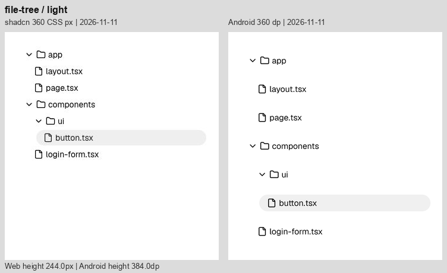
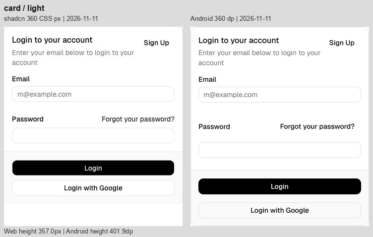
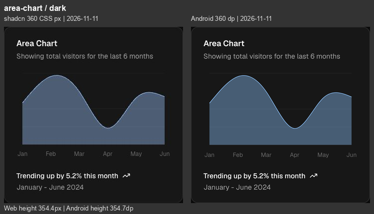

# Android 修正后同宽复查 · 2026-11-11

**仍有可见差异，集中在列表密度、消息工具栏、登录卡片及少量排版/颜色。** 输入区、基本单控件和图表几何布局已经比较接近原站。

本次在 `codex/android-port` 重新采集当前 Android 的 **36 种组件、37 个样例状态、浅深色共 74 张原始截图**，逐项对照同日原站截图。新 Android 截图与上一轮最终截图 74/74 逐字节一致，因此复用已交付的 74 张对照图，不重复保存相同图片。实际采集成功：1 个批量截图测试，24 秒；这不是重跑全部交互测试。

[逐项剩余差异图库](Images/AndroidRefinement-2026-11-11/remaining.html) · [本次采集与文件指纹](../Reference/android-visual-postfix-review-2026-11-11.json) · [上一轮修正记录](Android-Visual-Refinement-2026-11-11.md)

## 比较口径

- 统一 360 CSS px / 360 dp 内容画布；每张图左为原站、右为当前 Android，保留自然高度，不纵向拉伸。
- File Tree 内宽仍为 320；Input/Select/Progress 为 320/192/216。八个小型单控件统一置于 360×64 比较画布，64 不能当成控件的可见高度。
- Android 为 API 35 模拟器、密度 2.625、默认字号。样例文案、数据与展开状态一致。
- 原站完整参考是今天较早采集的 74 张截图，本轮没有声称全部重新采集网页。本轮现场重新打开并截图抽查 Prompt Input、File Tree、Bar Chart：尺寸仍为 360×160、320×244、360×354.375，文件树每行仍为 28。
- 网页 JPEG 和原生 PNG 存在压缩、颜色管理和字体栅格化差别。颜色仅做目视判断，不用像素相似度打分，也不将全部差别笼统归为平台原因。
- 本轮为视觉审查，没有修改组件实现。未新增弹窗、菜单、加载中或大字号状态的对照；上一轮多尺寸与交互验证另见验证记录。

## 最值得继续处理的地方

1. **列表密度与外部留白。** File Tree 多 140，Queue 多 128.8，Stack Trace 多 129.2，Sources 多 108.9。48 dp 的独立触控行是主要原因；可以继续检查非点击留白，但不能在保留独立 48 dp 行的同时声称能还原网页 28 行高。
2. **Card 表单与页脚。** 总高 401.9 对比 357；Password/Forgot 行开始逐步偏下。应核对标签、输入框命中区域和页脚可见按钮之间的重复间距。
3. **Message 工具栏与代码排版。** 图标中心间距约 48，而网页更紧；复制按钮所在标题区仍更高，行号和命令略右移。保留触控范围后，仍可单独校准代码区的可见对齐。
4. **Chat、Reasoning、Confirmation。** Chat 空态和页眉间距、Reasoning 行距/段距、审批面板分栏仍有独立的排版偏差，不应全部归因于点击范围。
5. **深色面积图和细节。** 几何高度已接近，仍应进一步核对颜色合成；基础控件只剩边框、字体基线和像素边缘的小差异。

## 逐个组件

“明显 / 中 / 轻”为视觉差异程度，不是功能缺陷严重级别。高度差为 Android 减原站；小型控件标为“画布”，不计算误导性的高度差。

| 组件 | 程度 | 原站 / Android 总高 | 高度差 | 当前仍可见的差异 | 浅色 | 深色 |
| --- | --- | ---: | ---: | --- | --- | --- |
| [Chain of Thought](https://ui.shadcn.com/docs/ai-elements/base/chain-of-thought) | 中 | 288.0 / 297.5 | +9.5 | 展开入口及回答仍偏下；总高仅多 9.5，不能掩盖正文起点约 28 的位移。主要关联 48 dp 展开行。 | [查看](Images/AndroidRefinement-2026-11-11/chain-of-thought-light.png) | [查看](Images/AndroidRefinement-2026-11-11/chain-of-thought-dark.png) |
| [Chat](https://ui.shadcn.com/docs/ai-elements/base/chat) | 中 | 800.0 / 800.0 | +0.0 | 空态图标与说明仍略偏上；页眉标题/说明间距偏紧，重置按钮位置也略低。输入圆钮已接近原站。两侧总高均 800 不代表内部对齐。 | [查看](Images/AndroidRefinement-2026-11-11/chat-light.png) | [查看](Images/AndroidRefinement-2026-11-11/chat-dark.png) |
| [Checkpoint](https://ui.shadcn.com/docs/ai-elements/base/checkpoint) | 中 | 288.0 / 290.7 | +2.7 | 状态文字字号已接近；分隔区更高，第二组消息下移，Restore 的字重/颜色与原站不同。 | [查看](Images/AndroidRefinement-2026-11-11/checkpoint-light.png) | [查看](Images/AndroidRefinement-2026-11-11/checkpoint-dark.png) |
| [Confirmation 初始态](https://ui.shadcn.com/docs/ai-elements/base/confirmation) | 轻 | 288.0 / 288.0 | +0.0 | 可见按钮在 288 高画布内仍约高 10；按钮自身的形状接近。 | [查看](Images/AndroidRefinement-2026-11-11/confirmation-light.png) | [查看](Images/AndroidRefinement-2026-11-11/confirmation-dark.png) |
| [Confirmation 待审批](https://ui.shadcn.com/docs/ai-elements/base/confirmation) | 中 | 288.0 / 327.6 | +39.6 | Thought 入口和审批面板下移；说明列更窄、文字多换一行，Deny/Approve 向右偏。 | [查看](Images/AndroidRefinement-2026-11-11/confirmation-approval-light.png) | [查看](Images/AndroidRefinement-2026-11-11/confirmation-approval-dark.png) |
| [Context](https://ui.shadcn.com/docs/ai-elements/base/context) | 轻 | 124.0 / 144.0 | +20.0 | 胶囊外观接近；独立 48 dp 点击范围使画布增高 20，中心向下偏 10。 | [查看](Images/AndroidRefinement-2026-11-11/context-light.png) | [查看](Images/AndroidRefinement-2026-11-11/context-dark.png) |
| [File Tree](https://ui.shadcn.com/docs/ai-elements/base/file-tree) | 明显 | 244.0 / 384.0 | +140.0 | 7 个可点击行均为 48，网页为 28，累计高出 140；缩进和浅色选中底色已改善。保留触控尺寸时，这一密度差仍会存在。 | [查看](Images/AndroidRefinement-2026-11-11/file-tree-light.png) | [查看](Images/AndroidRefinement-2026-11-11/file-tree-dark.png) |
| [Inline Citation](https://ui.shadcn.com/docs/ai-elements/base/inline-citation) | 轻 | 374.0 / 369.5 | -4.5 | 主要断行已接近；徽标占位、圆底宽度和文本基线仍有细差，最后一段总高度略少。 | [查看](Images/AndroidRefinement-2026-11-11/inline-citation-light.png) | [查看](Images/AndroidRefinement-2026-11-11/inline-citation-dark.png) |
| [Message](https://ui.shadcn.com/docs/ai-elements/base/message) | 明显 | 434.2 / 459.8 | +25.6 | 操作图标中心间距仍明显更宽；代码标题/复制行更高，命令与行号偏右。行内代码已补上圆角和内距，余下字形/基线有细差。 | [查看](Images/AndroidRefinement-2026-11-11/message-light.png) | [查看](Images/AndroidRefinement-2026-11-11/message-dark.png) |
| [Model Selector](https://ui.shadcn.com/docs/ai-elements/base/model-selector) | 轻 | 160.0 / 160.4 | +0.4 | 32 高的模型/Effort 胶囊、文字边距与外框已接近；横向位置、文字基线和深色边框仍有小差别。 | [查看](Images/AndroidRefinement-2026-11-11/model-selector-light.png) | [查看](Images/AndroidRefinement-2026-11-11/model-selector-dark.png) |
| [Plan](https://ui.shadcn.com/docs/ai-elements/base/plan) | 中 | 367.5 / 409.1 | +41.6 | 静态步骤间距接近；可展开标题较高，使步骤连接线、回答与 Replay 整体下移。 | [查看](Images/AndroidRefinement-2026-11-11/plan-light.png) | [查看](Images/AndroidRefinement-2026-11-11/plan-dark.png) |
| [Prompt Input](https://ui.shadcn.com/docs/ai-elements/base/prompt-input) | 轻 | 160.0 / 160.4 | +0.4 | 整体尺寸与内部可见控件已接近，仍有少量控件横向偏移、占位文字基线和边框差异。 | [查看](Images/AndroidRefinement-2026-11-11/prompt-input-light.png) | [查看](Images/AndroidRefinement-2026-11-11/prompt-input-dark.png) |
| [Queue](https://ui.shadcn.com/docs/ai-elements/base/queue) | 明显 | 344.8 / 473.5 | +128.8 | 4 个任务行仍比网页高 20 左右；去除额外行间距后，回答及 Replay 仍明显下移。 | [查看](Images/AndroidRefinement-2026-11-11/queue-light.png) | [查看](Images/AndroidRefinement-2026-11-11/queue-dark.png) |
| [Reasoning](https://ui.shadcn.com/docs/ai-elements/base/reasoning) | 中 | 417.2 / 438.9 | +21.6 | 标题入口及第一段偏下；正文行距和段间距较紧，抵消部分入口差值，回答起点接近但段落节奏不同。 | [查看](Images/AndroidRefinement-2026-11-11/reasoning-light.png) | [查看](Images/AndroidRefinement-2026-11-11/reasoning-dark.png) |
| [Sources](https://ui.shadcn.com/docs/ai-elements/base/sources) | 明显 | 339.5 / 448.4 | +108.9 | 三条可点击来源行较高，Replay 大幅下移；来源文本左起点仍略偏左。 | [查看](Images/AndroidRefinement-2026-11-11/sources-light.png) | [查看](Images/AndroidRefinement-2026-11-11/sources-dark.png) |
| [Stack Trace](https://ui.shadcn.com/docs/ai-elements/base/stack-trace) | 明显 | 384.8 / 513.9 | +129.2 | 源码行和框架入口仍更松；错误正文与后续回答下移，红色较鲜。两侧均有层级竖线，不能将竖线本身误判为多余。 | [查看](Images/AndroidRefinement-2026-11-11/stack-trace-light.png) | [查看](Images/AndroidRefinement-2026-11-11/stack-trace-dark.png) |
| [Subagent](https://ui.shadcn.com/docs/ai-elements/base/subagent) | 明显 | 459.8 / 549.3 | +89.6 | 工具入口逐行增高，说明和结论下移；长命令的省略位置与说明行距仍不同。 | [查看](Images/AndroidRefinement-2026-11-11/subagent-light.png) | [查看](Images/AndroidRefinement-2026-11-11/subagent-dark.png) |
| [Suggestion](https://ui.shadcn.com/docs/ai-elements/base/suggestion) | 中 | 196.0 / 224.4 | +28.4 | 渐隐效果已存在，但 48 dp 建议行加外部间隔使输入框比网页低约 28；第三条建议的露出范围也不同。 | [查看](Images/AndroidRefinement-2026-11-11/suggestion-light.png) | [查看](Images/AndroidRefinement-2026-11-11/suggestion-dark.png) |
| [Task](https://ui.shadcn.com/docs/ai-elements/base/task) | 中 | 299.5 / 368.4 | +68.9 | 两个工具入口使后续回答和 Replay 下移；正文路径的折行位置也不同。 | [查看](Images/AndroidRefinement-2026-11-11/task-light.png) | [查看](Images/AndroidRefinement-2026-11-11/task-dark.png) |
| [Terminal](https://ui.shadcn.com/docs/ai-elements/base/terminal) | 明显 | 532.8 / 613.3 | +80.6 | 三个命令入口使输出块下移；长命令/表格断行不同。底部渐隐与圆角已补齐，当前差别不能归为缺失渐隐。 | [查看](Images/AndroidRefinement-2026-11-11/terminal-light.png) | [查看](Images/AndroidRefinement-2026-11-11/terminal-dark.png) |
| [Test Results](https://ui.shadcn.com/docs/ai-elements/base/test-results) | 明显 | 502.2 / 599.6 | +97.4 | 测试文件与失败项入口逐层增高，错误块和结论下移；堆栈路径的换行位置不同。 | [查看](Images/AndroidRefinement-2026-11-11/test-results-light.png) | [查看](Images/AndroidRefinement-2026-11-11/test-results-dark.png) |
| [Tool](https://ui.shadcn.com/docs/ai-elements/base/tool) | 明显 | 320.2 / 401.9 | +81.7 | 三条工具入口比网页高，错误输出和结论随之下移；代码字形、内距有细差。 | [查看](Images/AndroidRefinement-2026-11-11/tool-light.png) | [查看](Images/AndroidRefinement-2026-11-11/tool-dark.png) |
| [Stack](https://ui.shadcn.com/docs/components/base/separator) | 轻 | 113.0 / 113.9 | +0.9 | 高度差已缩到约 0.9，剩余是标题/分隔线基线和边缘细差。 | [查看](Images/AndroidRefinement-2026-11-11/stack-light.png) | [查看](Images/AndroidRefinement-2026-11-11/stack-dark.png) |
| [Row](https://ui.shadcn.com/docs/components/base/badge) | 轻 | 64.0 / 64.0 | 画布 | 四个徽标排列已接近；单项字形占宽、边框与底色仍有小差别。 | [查看](Images/AndroidRefinement-2026-11-11/row-light.png) | [查看](Images/AndroidRefinement-2026-11-11/row-dark.png) |
| [Card](https://ui.shadcn.com/docs/components/base/card) | 明显 | 357.0 / 401.9 | +44.9 | Sign Up 已上移，但 Password/Forgot 行、密码输入框、页脚分隔线仍逐步下移；总高仍多约 44.9。页脚按钮间距也更大。 | [查看](Images/AndroidRefinement-2026-11-11/card-light.png) | [查看](Images/AndroidRefinement-2026-11-11/card-dark.png) |
| [Text](https://ui.shadcn.com/docs/components/base/separator) | 轻 | 40.0 / 40.4 | +0.4 | 正文换行一致，高度只多约 0.4；主要是字形栅格化细差。 | [查看](Images/AndroidRefinement-2026-11-11/text-light.png) | [查看](Images/AndroidRefinement-2026-11-11/text-dark.png) |
| [Button](https://ui.shadcn.com/docs/components/base/button) | 轻 | 64.0 / 64.0 | 画布 | 可见高度约 32，形状接近；宽度、文字基线和边缘有细差。64 为对照画布高度。 | [查看](Images/AndroidRefinement-2026-11-11/button-light.png) | [查看](Images/AndroidRefinement-2026-11-11/button-dark.png) |
| [Badge](https://ui.shadcn.com/docs/components/base/badge) | 轻 | 64.0 / 64.0 | 画布 | 浅色错误底色已修正；标签宽度、文字和圆角边缘仍有细差。 | [查看](Images/AndroidRefinement-2026-11-11/badge-light.png) | [查看](Images/AndroidRefinement-2026-11-11/badge-dark.png) |
| [Input](https://ui.shadcn.com/docs/components/base/input) | 轻 | 64.0 / 64.0 | 画布 | 320 内宽、32 可见高度接近；深色填充和边框更明显，文字起点略不同。 | [查看](Images/AndroidRefinement-2026-11-11/input-light.png) | [查看](Images/AndroidRefinement-2026-11-11/input-dark.png) |
| [Select](https://ui.shadcn.com/docs/components/base/select) | 轻 | 64.0 / 64.0 | 画布 | 192 内宽、32 可见高度接近；文字/箭头基线、深色边框与填充仍有细差。 | [查看](Images/AndroidRefinement-2026-11-11/select-light.png) | [查看](Images/AndroidRefinement-2026-11-11/select-dark.png) |
| [Switch](https://ui.shadcn.com/docs/components/base/switch) | 轻 | 64.0 / 64.0 | 画布 | 轨道尺寸、滑块和标签关系接近；边缘与字形占宽略不同。 | [查看](Images/AndroidRefinement-2026-11-11/switch-light.png) | [查看](Images/AndroidRefinement-2026-11-11/switch-dark.png) |
| [Progress](https://ui.shadcn.com/docs/components/base/progress) | 轻 | 64.0 / 64.0 | 画布 | 216 宽、4 高、66% 进度一致；起点圆角与像素边缘略不同。 | [查看](Images/AndroidRefinement-2026-11-11/progress-light.png) | [查看](Images/AndroidRefinement-2026-11-11/progress-dark.png) |
| [Separator](https://ui.shadcn.com/docs/components/base/separator) | 轻 | 64.0 / 64.0 | 画布 | 360 宽、1 高一致；细线明暗与像素取整略不同。 | [查看](Images/AndroidRefinement-2026-11-11/separator-light.png) | [查看](Images/AndroidRefinement-2026-11-11/separator-dark.png) |
| [Table](https://ui.shadcn.com/docs/components/base/table) | 轻 | 371.5 / 374.9 | +3.4 | 四列与金额完整；行分隔线逐渐偏下，总高多约 3.4，Status/Method 列边界有小偏移。 | [查看](Images/AndroidRefinement-2026-11-11/table-light.png) | [查看](Images/AndroidRefinement-2026-11-11/table-dark.png) |
| [Bar Chart](https://ui.shadcn.com/view/new-york-v4/chart-bar-default) | 轻 | 354.4 / 354.7 | +0.3 | 高度差仅约 0.3，标题/页脚对齐明显改善；柱色、网格线和边缘仍不同。 | [查看](Images/AndroidRefinement-2026-11-11/bar-chart-light.png) | [查看](Images/AndroidRefinement-2026-11-11/bar-chart-dark.png) |
| [Line Chart](https://ui.shadcn.com/view/new-york-v4/chart-line-default) | 轻 | 354.4 / 354.7 | +0.3 | 自然曲线形状、布局已接近；描边颜色、细网格与抗锯齿仍不同，高度差约 0.3。 | [查看](Images/AndroidRefinement-2026-11-11/line-chart-light.png) | [查看](Images/AndroidRefinement-2026-11-11/line-chart-dark.png) |
| [Area Chart](https://ui.shadcn.com/view/new-york-v4/chart-area-default) | 中 | 354.4 / 354.7 | +0.3 | 高度差仅约 0.3；深色面积填充仍偏蓝灰且略暗，网格/描边略不同。截图色差不足以单独证明代码色值错误。 | [查看](Images/AndroidRefinement-2026-11-11/area-chart-light.png) | [查看](Images/AndroidRefinement-2026-11-11/area-chart-dark.png) |

## 代表性证据

文件树：同为 320 内宽，行高为 28 与 48。

卡片：页眉改善后，Password 操作行和页脚仍拉高布局。

深色面积图：几何布局接近，色调仍有可见差异。

## 可追溯性

原始 Android 新截图在 `.build/android-postfix-review-2026-11-11/android/`；本轮三张网页现场抽查在该目录的 `web-spotcheck/`；批量截图日志为 `capture.log`。文件指纹记录包含所有 74 张新旧原生图的匹配结果、对应网页/对照图哈希与当前 Kotlin 源码哈希。

本轮只检查视觉，不给未经验证的功能、键盘或读屏流程评分。原生截图与源码由当前上下文直接复核，没有运行仅适用于网页结构的检测器。没有需要用户补充才能完成本轮截图比较的信息，因此未追加问题。
