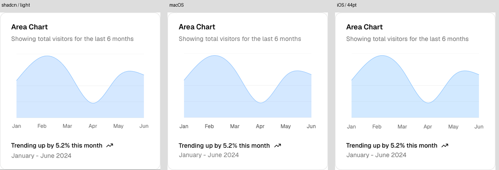
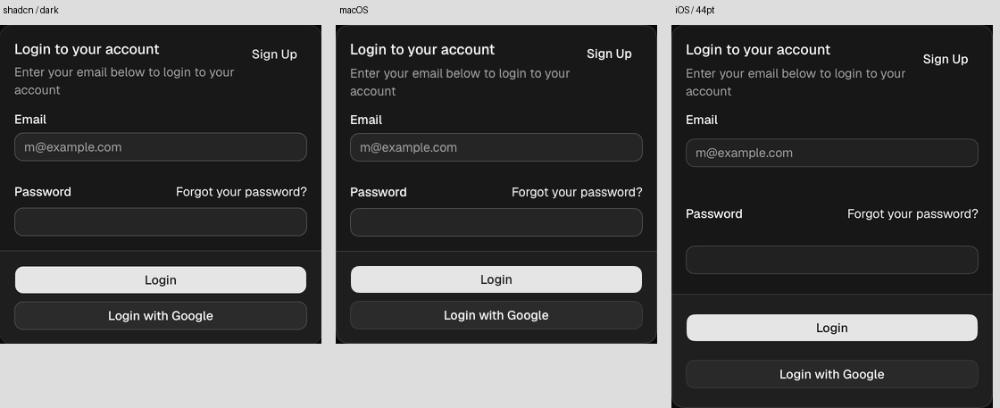

# 15 种基础组件同宽视觉验收

2026-11-08。两轮核对 15 种新增基础节点，修复后分别导出 macOS、iOS 的浅色和深色界面，并与 shadcn 官方示例逐项并排。下方共有 **30 张对照图**，每张从左到右是 **原站、macOS、iOS**，对应 30 张网页截图与 60 张原生截图。

本轮没有扩展为 shadcn 全组件、全变体认证；原有 21 个 AI Elements 模式也不是本轮截图矩阵的对象。

## 第二轮复核

重新采集全部 **30 张官方截图和 60 张原生截图**，下方对照图已更新为第二轮结果。修复深色 Progress 误用前景白色的问题，改用与原站一致的主色；同时为没有可见标签的 Select 补上占位文字作为辅助功能名称。

两端重新编译，51 项测试通过。实际默认密度控件的布局尺寸如下，测量不包含截图画布或可选标签：

| 控件 | macOS 高度 | iOS 高度 |
| --- | ---: | ---: |
| Button | 32 pt | 44 pt |
| Input | 32 pt | 44 pt |
| Select | 32 pt | 44 pt |
| Switch | 19 pt | 44 pt |

iOS 保留外层 44 pt 命中区域，未用缩小控件外框来追平网页高度。尺寸由原生 hosting view 实测，另结合 `.aiHitTarget` 实现检查；这不是自动化边缘点击或完整 VoiceOver 验收。[原始尺寸记录](../Reference/foundation-control-sizes.json)。

深色面积图额外做了浏览器 sRGB 合成实验：官方 Lab 色值与 40% 透明度合成为 RGB(71, 93, 117)，iOS 截图约为 RGB(71, 93, 116)。这支持剩余差异主要来自截图色彩管理/合成路径的判断；保留一档通道值误差，不以显示器截图颜色反向修改语义色。[实验记录](../Reference/foundation-color-probe.json)。

## 比较方法

- 统一画布宽度为 **360 CSS px / SwiftUI pt**。Card、文字、表格、图表占满该宽度。Input 保留官方示例的 320 宽，Select 为 192，Progress 为 216；按钮、徽章、开关按内容取宽，放入 360×64 画布。
- 文档页保持桌面字体断点，仅临时调整预览容器宽度，使内侧内容宽度为 360；不改动组件自身样式。图表独立预览页使用 360 宽视口。采集结束后移除视口覆盖并关闭研究标签页。
- 使用同一份文本、选项、表格行与图表数据。进度条等待至 66%，图表等待曲线与裁剪动画结束，移走截图中的指针。
- macOS 来自 NSHostingView 实际渲染，iOS 来自 **iPhone 17 Pro / iOS 27.0** 模拟器的 UIHostingController；本机 macOS 27.0.1。截图导出器关闭额外安全区，不改变组件内部排版。
- 原始图片携带不同 ICC 配置，合成前转换到 sRGB，再按 1 CSS px / pt 展示。仅做色彩转换、分辨率归一和画布留白，没有涂改组件、拉伸高度或隐藏差异。
- Stack、Row、Text 是协议布局/文字节点，原站没有同名组件。Stack 对照 Separator 示例的竖向排版，Row 对照 Badge 示例的横排，Text 对照 Separator 示例正文。

## 逐项结果

| 节点 | 官方参照与累计修正 | 浅色 | 深色 |
| --- | --- | --- | --- |
| Stack | [Separator 示例](https://ui.shadcn.com/docs/components/base/separator)：16/6 间距、14 pt medium 标题和 20 pt 正文行高；修复 iOS 首行模糊 | [查看](Images/Foundation/stack-light.png) | [查看](Images/Foundation/stack-dark.png) |
| Row | [Badge 示例横排](https://ui.shadcn.com/docs/components/base/badge)：8 pt 间隔，跟随徽章宽度；窄空间仍可纵向回退 | [查看](Images/Foundation/row-light.png) | [查看](Images/Foundation/row-dark.png) |
| Card | [登录卡片](https://ui.shadcn.com/docs/components/base/card)：基础卡片与图表卡片分开，16 pt 内边距、标题描述间距、头部操作、带底色的页脚及分隔线 | [查看](Images/Foundation/card-light.png) | [查看](Images/Foundation/card-dark.png) |
| Text | [Separator 正文](https://ui.shadcn.com/docs/components/base/separator)：20 pt 行高和相同换行；关闭静态段落上的滚动边缘模糊 | [查看](Images/Foundation/text-light.png) | [查看](Images/Foundation/text-dark.png) |
| Button | [默认按钮](https://ui.shadcn.com/docs/components/base/button)：36→32 pt 外观高度、10 pt 圆角、内边距与透明边框占位，纠正 macOS 标签字重 | [查看](Images/Foundation/button-light.png) | [查看](Images/Foundation/button-dark.png) |
| Badge | [四种徽章](https://ui.shadcn.com/docs/components/base/badge)：20 pt 高、胶囊边缘与文字内距；Destructive 改为浅红底红字，深色主色反转 | [查看](Images/Foundation/badge-light.png) | [查看](Images/Foundation/badge-dark.png) |
| Input | [无标签输入框](https://ui.shadcn.com/docs/components/base/input)：去掉空标签占位、32 pt 外观高度、占位字重、深色背景与 15% 边框 | [查看](Images/Foundation/input-light.png) | [查看](Images/Foundation/input-dark.png) |
| Select | [水果选择器](https://ui.shadcn.com/docs/components/base/select)：32 pt 高、10 pt 圆角、单向下箭头、占位文字颜色与深色输入边框 | [查看](Images/Foundation/select-light.png) | [查看](Images/Foundation/select-dark.png) |
| Switch | [Airplane Mode](https://ui.shadcn.com/docs/components/base/switch)：32×18.4 外观、16 pt 滑块、8 pt 标签间隔和深色关闭状态的浅色滑块 | [查看](Images/Foundation/switch-light.png) | [查看](Images/Foundation/switch-dark.png) |
| Progress | [66% 进度](https://ui.shadcn.com/docs/components/base/progress)：8→4 pt 轨道，改为 muted 底色，固定同一进度值；第二轮修正深色填充为主色 | [查看](Images/Foundation/progress-light.png) | [查看](Images/Foundation/progress-dark.png) |
| Separator | [横向分隔线](https://ui.shadcn.com/docs/components/base/separator)：核对 1 pt 高度和浅深色边框色，无额外装饰 | [查看](Images/Foundation/separator-light.png) | [查看](Images/Foundation/separator-dark.png) |
| Table | [发票表格](https://ui.shadcn.com/docs/components/base/table)：移除每列至少 96 pt 的限制，匹配紧凑行高、首列宽度/字重、金额右对齐、合计行和说明间距；修复 iOS 表头模糊 | [查看](Images/Foundation/table-light.png) | [查看](Images/Foundation/table-dark.png) |
| BarChart | [默认柱状图](https://ui.shadcn.com/view/new-york-v4/chart-bar-default)：卡片总高、4 条网格、暗色轴标签和字形基线 | [查看](Images/Foundation/bar-chart-light.png) | [查看](Images/Foundation/bar-chart-dark.png) |
| LineChart | [默认折线图](https://ui.shadcn.com/view/new-york-v4/chart-line-default)：直线改为自然三次曲线，修正两端 12 pt 留白、坐标映射和网格 | [查看](Images/Foundation/line-chart-light.png) | [查看](Images/Foundation/line-chart-dark.png) |
| AreaChart | [默认面积图](https://ui.shadcn.com/view/new-york-v4/chart-area-default)：自然曲线、1 pt 描边，渐变改为 40% 纯色填充；使用原例描述与页脚 | [查看](Images/Foundation/area-chart-light.png) | [查看](Images/Foundation/area-chart-dark.png) |





## 保留的差异与验证边界

**iOS 触控区域至少 44 pt。** 按钮、输入框、菜单和开关的外观可以小于 44，但外层命中区域不缩小；相邻控件不通过负间距挤在一起。因此登录卡片的纵向间隔与整体高度大于网页/macOS，这是本轮明确保留的可用性差异。登录卡片同时演示原生 Card 的 SwiftUI 组合插槽，并非一个提供同等插槽属性的 JSON 节点样例。

仍能看到 CoreText/UIKit 与 Chrome 的字形抗锯齿、半像素取整和少量灰阶差异。半透明颜色还受截图源的合成色彩空间影响：深色 Area 在 iOS 截图中比 Chrome/macOS 稍暗；保留官方 40% 透明度与语义颜色，没有把当前显示器的混色结果硬编码为跨设备颜色。这些截图不能证明逐像素完全相同。

Select 展开使用原生菜单，输入使用原生编辑行为；截图矩阵比较默认/关闭状态，不声称所有 hover、focus、disabled、菜单展开、VoiceOver、辅助字号和横屏状态都已完成同宽视觉验收。本轮 iOS 是模拟器渲染与构建验证，没有真机验收。

## 构建与行为验证

第二轮重新执行两端构建、51 项测试与全部截图导出；以下交互及独立消费者检查为第一轮记录。

- **51 项单元测试通过**：31 项组件库、11 项协议、9 项 CLI。新增自然曲线端点/曲率连续性、图表坐标映射和新增表现属性的非法输入验证。
- iOS 与 macOS 示例均通过 Debug 编译；iOS 安装、启动并导出全部 30 张浅深色组件截图。
- macOS 实际操作验证：编辑名称、切换 Switch、修改 Select、点击 Save，观察到 `Save requested: Foundation QA`；切换深色外观成功。
- CLI 与独立消费者检查覆盖既有 21 个示例，验证新属性没有破坏旧组件接入。
- 原有 21 个模式共享的静态段落也关闭 iOS 26+ 的滚动边缘效果，避免系统误将不可滚动的文字当成需要模糊边缘的滚动内容。

## 重现原生截图

```sh
swift run AIElementsGallery --foundation-snapshots --output .build/foundation-audit/native
```

iOS 示例以 `--foundation-snapshots` 启动，图片写入 App Documents/foundation-audit。
单项预览参数：`--foundation-preview stack|row|card|text|button|badge|input|select|switch|progress|separator|table|bar-chart|line-chart|area-chart`，追加 `--dark` 可切换深色。

原始浏览器/两端前后截图与日志保留于本机 `.build/foundation-audit/`；公开对照图位于本目录 Images/Foundation。官方测量摘要在 [Reference/foundation-metrics.json](../Reference/foundation-metrics.json)。上游设计、字体、图标与截图示例的出处见 [第三方声明](../THIRD_PARTY_NOTICES.md)。
