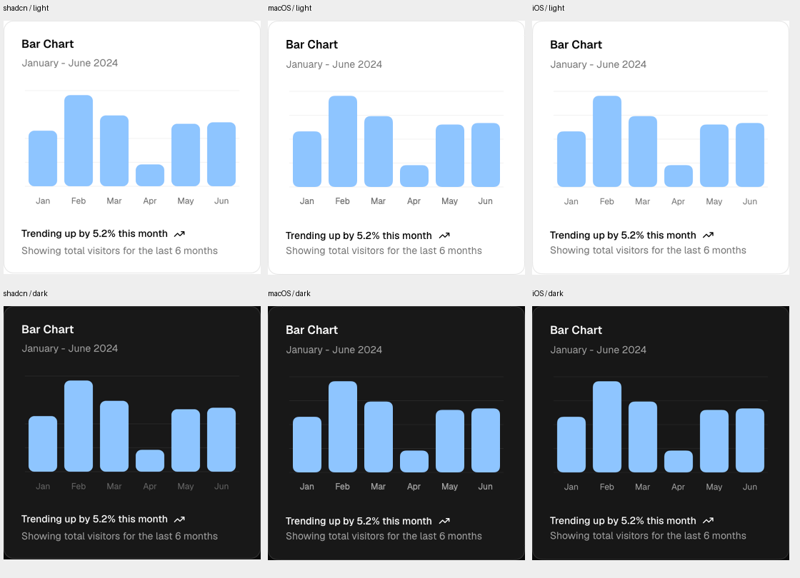

# Streaming UI validation — 2026-11-08

Scope: new protocol/renderer and first foundation catalog; existing 21 AI Elements
patterns remain. This is not a claim that all shadcn components or chart variants
have been ported or visually certified.

## Visual evidence

Each card is 360 CSS px / SwiftUI pt wide. Columns: original shadcn, macOS, iOS;
rows: light, dark. Source: [shadcn bar chart](https://ui.shadcn.com/view/new-york-v4/chart-bar-default),
MIT attribution in [third-party notices](../THIRD_PARTY_NOTICES.md). Screenshot origins
are Chrome, NSHostingView, and iPhone 17 Pro simulator. ICC profiles were converted
to sRGB before compositing; otherwise the Mac monitor profile produces a misleading
blue hue difference. No UI geometry was adjusted in the comparison image.

The bar-card structure, chart data, padding, radii, colors, and Geist/Lucide styling
follow the reference. Remaining small differences: native card height approximately
356 pt versus 354.375 CSS px, footer baseline and native text rasterization. Dark
axis labels are brighter in the native rendering. This is close visual correspondence,
not a claim of zero differing pixels.

Captured both appearances on macOS and iOS for Bar, Line, Area, complete dashboard,
partial generation, and interrupted generation (24 state captures). Line and Area
are supported native straight-segment variants; a separate per-variant original-site
pixel comparison was not performed. iOS controls retain 44 pt interaction areas;
menu surfaces use native platform presentation. Large Dynamic Type and physical
iPhone operation were not part of this round's verification.

Local full-size evidence: `.impeccable/review/streaming-ui/` (ignored build evidence).
Mac fixtures can be reproduced with `swift run AIElementsGallery --ui-snapshots`;
the demo apps also accept `--ui-preview bar-chart|line-chart|area-chart|dashboard|partial|interrupted`
and `--dark`, with a fixed 360 pt content width. Normal interactive gallery entry:
`--pattern generative-ui`.

## Functional checks

- 48 unit tests passed: 29 library, 10 protocol, 9 CLI.
- Protocol checks include UTF-8 split at every byte, intermediate rendering, ordered
  revisions, transactional invalid-patch rejection, user drafts during chart updates,
  malformed/truncated streams, graph validation, and explicit action-state export.
- iOS and macOS example apps compiled with Xcode; iOS installed and launched on the
  original iPhone 17 Pro simulator. Both platforms loaded resources and rendered the
  new fixtures; iOS's different resource-bundle layout was fixed during verification.
- macOS live interaction: Stop preserves partial content, Replay restarts generation,
  form draft survives stream completion, Select and Switch update state, and Save
  produces an action callback. The demo does not persist a report or call a model.
- CLI example/stream validation and a relocated release installation were exercised;
  installation includes both resource bundles. Agent Skill validation passed.
- Independent finish review requested two fixes: accurate save-request wording and
  updated product scope. Both were verified resolved; that final ship verdict covers
  those fixes, not untested chart variants or accessibility sizes.
