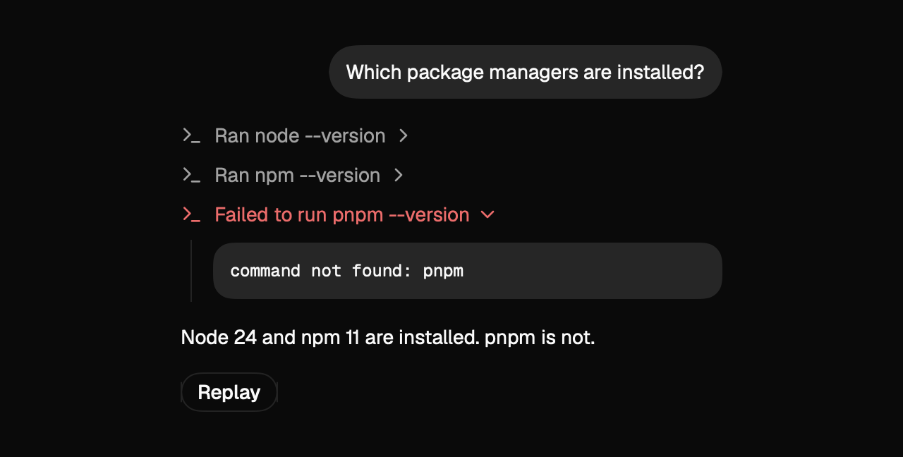
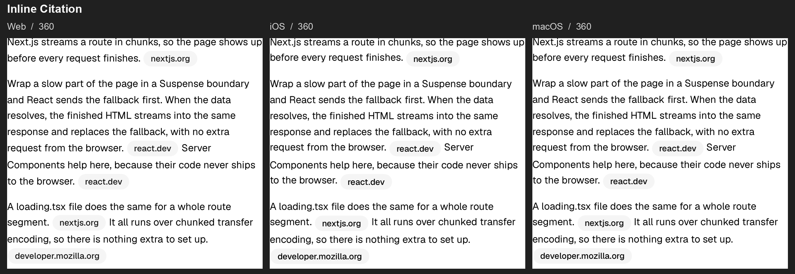

# AIElements for SwiftUI

**A native SwiftUI port of [shadcn/ui AI Elements](https://ui.shadcn.com/docs/ai-elements), for iOS, iPadOS, and macOS.**

将 shadcn/ui AI Elements 的 21 个界面模式实现为可复用的 SwiftUI 组件。包含浅深色主题、Geist 字体、Lucide 矢量图标和可交互示例，无第三方运行时依赖。

**Android 版本**：新增原生 Kotlin + Jetpack Compose 组件库和示例画廊，覆盖同名 21 个 AI 模式及 15 种基础节点，复用本仓库的流式 UI 协议与样例。Android 8.0+，支持浅深色和手机／平板布局。[Android 接入与运行](Android/README.md) · [安卓验证记录](Documentation/Android-Validation.md) · [安卓同宽视觉对比](Documentation/Android-Visual-Fidelity-2026-11-11.md)。安卓是独立实现，差异见接入文档；下文的 Swift 安装方式和 CLI 仍用于 Apple 平台。

**新增流式生成 UI**：AI 可以先生成卡片、再逐步补齐表单和图表；用户操作回传宿主继续更新。提供独立 JSONL 协议、原生渲染器和 15 种基础节点（含 Bar / Line / Area Chart）。[协议与接入示例](Documentation/StreamingUI.md)。[15 种基础组件双端浅深色对照](Documentation/Foundation-Visual-Validation.md)。这是独立实现，不是 OpenAI Intelligent UI 的私有协议。

同时提供 **`aielements` CLI + `aielements-swiftui` Agent Skill**：让 AI 编程工具查询当前组件 API、读取完整 Swift 示例，并生成可接入现有 App 的 UI Package。[直接开始使用 CLI 和 Skill ↓](#ai-编程工具cli--skill)

> **非官方项目 / Unofficial port**：原始界面模式、视觉设计及参考示例来自 [shadcn/ui](https://github.com/shadcn-ui/ui)。本仓库由 elloray 独立维护，不隶属于 shadcn、shadcn/ui 或 Vercel，也不代表其官方 Swift 产品或背书。原作者及资源许可详见 [致谢与许可](#致谢与许可)。



## 平台与范围

- iOS / iPadOS **17+**，macOS **14+**；Swift tools **5.9+**。
- 同一个 `AIElements` Swift Package 产品用于两端。
- 组件提供界面、状态呈现和回调；模型调用、命令执行、附件上传及数据持久化由宿主负责。
- 以 2026-11-05 保存的官方目录为最初范围，并持续对照原站复核；21 个模式不等于原站所有子状态或旧版 AI SDK Elements 的全部组件。

## 流式 UI

```swift
@StateObject private var store = AIUIStore()

// 放在 AIMessage 或其他 SwiftUI 页面中
AIUIRenderer(store: store) { event in
    handleAction(event)
}

// 每收到一段网络数据就调用（MainActor），无需等完整界面
try store.receive(chunk)
// 连接结束：检查最后一帧是否完整，保留被中断时的界面
try store.finish()
```

在示例 App 中选择 **Generative UI**，可查看逐步生成、Stop / Replay、输入与图表交互。CLI 可直接输出 schema、完整文档、流式样例并校验：

```bash
./aielements ui schema
./aielements ui example dashboard
./aielements ui example select
./aielements example streaming-ui
./aielements ui stream > /tmp/report.jsonl
./aielements ui validate /tmp/report.jsonl
```

当前支持以下 **15 种协议节点**，可以由流式数据逐步创建和更新：

| 用途 | 节点 |
| --- | --- |
| 布局与内容 | `Stack`、`Row`、`Card`、`Text`、`Separator` |
| 操作与状态 | `Button`、`Badge`、`Progress` |
| 表单 | `Input`、`Select`、`Switch` |
| 数据展示 | `Table`、`BarChart`、`LineChart`、`AreaChart` |

基础组件以 [shadcn/ui 基础组件](https://ui.shadcn.com/docs/components)及图表示例为视觉参考；当前尚未移植全部基础组件或图表变体。节点属性、绑定和回调见 [协议目录](Documentation/StreamingUI.md#component-catalog)，最新视觉结果见 [15 种基础组件同宽验收](Documentation/Foundation-Visual-Validation.md)。

## 安装

### Xcode

选择 **File → Add Package Dependencies…**，输入：

```text
https://github.com/elloray/AIElements.git
```

当前使用 **Branch → main**，将 **AIElements** 产品加入 App target，然后 `import AIElements`。`main` 会随开发更新；需要固定构建时可锁定具体 commit。当前尚未发布语义化版本 tag。

### Swift Package Manager

```swift
// Package.swift
let package = Package(
    name: "MyApp",
    platforms: [.iOS(.v17), .macOS(.v14)],
    dependencies: [
        .package(url: "https://github.com/elloray/AIElements.git", branch: "main")
    ],
    targets: [
        .target(name: "MyApp", dependencies: [
            .product(name: "AIElements", package: "AIElements")
        ])
    ]
)
```

本地开发也可用 `.package(path: "../AIElements")`，或在 Xcode 中选择 **Add Local…**。

## AI 编程工具：CLI + Skill

**把下面这段话发给 AI 编程工具即可**，把最后一行换成你的需求：

```text
请使用 https://github.com/elloray/AIElements 为当前 Swift 项目开发界面。
先复用已有的 AIElements checkout；没有就自行 git clone 到项目旁的新目录。
读取仓库的 README.md 和 Tools/Skills/aielements-swiftui/SKILL.md，按其中指引接入。
用仓库里的 ./aielements 查询需要的组件和示例，沿用当前项目结构及模型服务。
我的需求：添加支持 iOS / macOS、系统浅深色的聊天页，iOS 保留 44 pt 触控区。
```

AI 工具可以直接读取仓库里的 Skill，按需查询 CLI，再修改和验证你的项目。**不用先安装 CLI、配置 PATH 或注册 Skill。**

### 自己试用

```bash
git clone https://github.com/elloray/AIElements.git
cd AIElements
./aielements list
./aielements show chat
```

需要 **macOS 14+ / Swift 5.9+**。`./aielements` 首次运行自动构建，之后复用缓存。它与 App 的 SwiftUI 库独立，不需要模型 API 或凭据。

在其他项目中，直接用 checkout 的路径调用：

```bash
/path/to/AIElements/aielements show AIFileTree --json
/path/to/AIElements/aielements example prompt-input
```

`show` 提供使用说明、原站链接和完整 Swift 示例；`example` 输出源码。目录覆盖 **21 个 AI 模式 + 15 种基础节点 + 1 个流式接入示例**，共 37 项；例如 `show select`、`show LineChart`、`example streaming-ui`。`ui example select` 则输出可校验的协议 JSON。CLI 的 `--json` 查询结果便于 AI 工具读取。

CLI 还可以生成新的 UI Package、安装项目级 Skill；这些是可选能力，完整命令见 [CLI 指南](Documentation/CLI.md)。已有 App 直接按 [使用指南](Documentation/Usage.md) 接入组件即可。

## 快速开始

```swift
import SwiftUI
import AIElements

struct AssistantView: View {
    @State private var draft = ""
    @State private var messages: [AIChatMessage] = []
    @State private var submissionRevision = 0

    var body: some View {
        VStack(spacing: 16) {
            AIChat(messages: messages)
            AIPromptInput(text: $draft, attachmentResetID: submissionRevision) { submission in
                messages.append(.init(
                    role: .user,
                    text: submission.text,
                    parts: submission.attachments.map { .attachment($0) }
                ))
                draft = ""
                submissionRevision += 1
                // 在这里调用自己的 AI 服务，并把响应写入 messages。
            }
        }
        .padding()
    }
}
```

也可以独立组合轨迹、工具和推理内容：

```swift
AITrace {
    AIReasoning("检查相关文件。", duration: 2)
    AITool("swift test", status: .completed, output: "All tests passed.")
}
```

示例中的命令和响应仅用于展示，组件不会执行这些命令。

## 21 个模式

下表第一列链接到 **shadcn/ui 的原始模式文档**；第二列是本项目提供的 SwiftUI API。

| 官方模式 | SwiftUI API | 主要行为 |
| --- | --- | --- |
| [Chain of Thought](https://ui.shadcn.com/docs/ai-elements/base/chain-of-thought) | `AIChainOfThought` | 汇总与嵌套步骤展开 |
| [Chat](https://ui.shadcn.com/docs/ai-elements/base/chat) | `AIChat`, `AIConversation` | 用户回合锚点、消息片段、流式跟随、回到底部 |
| [Checkpoint](https://ui.shadcn.com/docs/ai-elements/base/checkpoint) | `AICheckpoint` | 恢复回调 |
| [Confirmation](https://ui.shadcn.com/docs/ai-elements/base/confirmation) | `AIConfirmation` | 异步审批、失败重试、审批后工具状态 |
| [Context](https://ui.shadcn.com/docs/ai-elements/base/context) | `AIContext` | 用量百分比、详情与进度 |
| [File Tree](https://ui.shadcn.com/docs/ai-elements/base/file-tree) | `AIFileTree` | 保留子树展开状态、可控展开、文件选择 |
| [Inline Citation](https://ui.shadcn.com/docs/ai-elements/base/inline-citation) | `AICitedText`, `AIInlineCitation` | 原生行内引用、悬停／点击预览、多来源翻页 |
| [Message](https://ui.shadcn.com/docs/ai-elements/base/message) | `AIMessage`, `AIMessageResponse`, `AIMessageActions` | 角色、Markdown、复制／重试／反馈 |
| [Model Selector](https://ui.shadcn.com/docs/ai-elements/base/model-selector) | `AIModelSelector` | 分组模型与推理强度选择 |
| [Plan](https://ui.shadcn.com/docs/ai-elements/base/plan) | `AIPlan` | 计划步骤与完成计数 |
| [Prompt Input](https://ui.shadcn.com/docs/ai-elements/base/prompt-input) | `AIPromptInput` | 多行文本、文件选择、移除附件、发送／停止 |
| [Queue](https://ui.shadcn.com/docs/ai-elements/base/queue) | `AIQueue` | 待办／完成分组与选择回调 |
| [Reasoning](https://ui.shadcn.com/docs/ai-elements/base/reasoning) | `AIReasoning` | 流式展开、用时、手动折叠 |
| [Sources](https://ui.shadcn.com/docs/ai-elements/base/sources) | `AISources` | 来源列表与外部链接 |
| [Stack Trace](https://ui.shadcn.com/docs/ai-elements/base/stack-trace) | `AIStackTrace` | 错误与栈帧、源码跳转回调 |
| [Subagent](https://ui.shadcn.com/docs/ai-elements/base/subagent) | `AISubagent` | 子任务内容组合与结果 |
| [Suggestion](https://ui.shadcn.com/docs/ai-elements/base/suggestion) | `AISuggestion`, `AISuggestions` | 横向建议与选择回调 |
| [Task](https://ui.shadcn.com/docs/ai-elements/base/task) | `AITask` | 任务步骤展开 |
| [Terminal](https://ui.shadcn.com/docs/ai-elements/base/terminal) | `AITerminal` | 命令、输出、运行／错误状态 |
| [Test Results](https://ui.shadcn.com/docs/ai-elements/base/test-results) | `AITestResults` | 测试套件、失败详情与跳过状态 |
| [Tool](https://ui.shadcn.com/docs/ai-elements/base/tool) | `AITool` | 状态映射、输出折叠、长输出 Sheet |

基础构件还包括 `AITrace`、`AITraceLine`、`AITraceDisclosure`、`AICodeBlock`、`AIAttachmentView`、`AIIcon`、`AITextLabel`、`AIBadge` 和 `AIButtonStyle`。

## 主题与原生适配

默认跟随系统外观，也可以显式指定：

```swift
YourView()
    .aiTheme(.dark)
    .preferredColorScheme(.dark)
```

字体资源自动注册，无需在宿主 Info.plist 中添加字体配置，也不会修改全局 UIAppearance。

iOS 默认使用 `.comfortable` 密度，为交互保留至少 **44 pt 的独立触控区域**；macOS 默认 `.reference` 密度。因此 iOS 的部分列表会比网页更高，这是有意的原生适配。可按宿主场景选择：

```swift
YourView().aiControlDensity(.comfortable)
YourView().aiControlDensity(.reference)
```

更多内容见 [使用指南](Documentation/Usage.md)：受控状态、流式更新、审批、消息片段、原生引用、附件、键盘行为与自定义样式。

## 运行示例

```bash
git clone https://github.com/elloray/AIElements.git
cd AIElements
swift run AIElementsGallery
```

上面的命令运行 macOS 组件画廊。iOS / iPadOS 示例用 Xcode 打开：

```bash
open Examples/AIElementsDemo.xcodeproj
```

选择 `AIElementsDemo` + iPhone / iPad Simulator，或 `AIElementsMac` + My Mac。示例工程默认禁用签名，用于模拟器和本机预览；真机运行需由使用者配置自己的签名身份。

`Examples/project.yml` 是 XcodeGen 源文件；只在需要重新生成工程时运行：

```bash
xcodegen generate --spec Examples/project.yml
```

## 验证与已知差异

项目以原站为视觉基准，分别记录原有 AI Elements 模式与新增基础组件的验证范围：

- **15 种基础节点（2026-11-08 第二轮）**：重新采集 30 张原站、60 张原生浅深色截图，以 **360 CSS px / SwiftUI pt** 画布形成 30 张「原站 / macOS / iOS」对照图；修正深色 Progress 填充颜色，并补全无标签 Select 的辅助功能名称。详见 [逐项结果与全部截图](Documentation/Foundation-Visual-Validation.md)。
- **构建与测试**：最新一轮 macOS `swift test` 共 **51 项通过**（组件库 31、协议 11、CLI 9）；iOS 和 macOS 示例均通过 Debug 构建，iOS 模拟器完成安装、启动与截图导出。此处不将 macOS 单元测试计为 iOS 测试。
- **iOS 触控区**：默认密度下 Button、Input、Select、Switch 的外层布局高度均实测为 **44 pt**，结合命中区实现检查；没有通过压缩触控区来匹配网页高度。[尺寸记录](Reference/foundation-control-sizes.json)。
- **原有 21 个模式**：已对默认示例及待审批态做过 360 CSS px / pt、2×、浅深色、双端对照；此前 iOS 包测试 30 项、macOS 包测试 29 项及 8 项针对性交互测试通过。这些为此前验收记录，不代表本轮重跑，详见 [验证范围](Documentation/VALIDATION.md)。

```bash
swift test
swift run AIElementsGallery --snapshots
swift run AIElementsGallery --foundation-snapshots --output .build/foundation-audit/native
```

后两条命令分别导出 macOS 的 AI Elements 模式截图和 15 种基础组件截图；两端复现方法见对应验收报告。仓库保留精选预览及 30 张基础组件对照图，原始截图、反复生成的历史截图、构建缓存和机器日志不纳入版本控制。



**还原目标不等于零像素误差。** SwiftUI、UIKit / AppKit 与浏览器仍有字形栅格化、系统菜单、输入法、取整和截图色彩合成差异；iOS 触控布局也刻意保留原生可用性。基础组件截图比较默认状态，没有覆盖所有展开、聚焦、禁用、动画、悬停或辅助字号状态。本轮 iOS 使用模拟器，未做真机或所有最低支持系统版本验收。

Markdown 支持常见富文本、列表、表格、图片及流式代码块；数学公式、Mermaid 和额外的语法高亮器可由宿主接入。此包不包含模型供应商 SDK。

## 致谢与许可

本项目的核心视觉参考来自 **[shadcn/ui AI Elements](https://ui.shadcn.com/docs/ai-elements)**、[基础组件](https://ui.shadcn.com/docs/components)及[图表示例](https://ui.shadcn.com/charts/bar)。感谢 [shadcn](https://github.com/shadcn) 及 [shadcn/ui 贡献者](https://github.com/shadcn-ui/ui/graphs/contributors) 提供这些界面模式、设计和示例。

| 来源 | 本项目中的用途 | 许可 |
| --- | --- | --- |
| [shadcn/ui](https://github.com/shadcn-ui/ui) | 原始 AI Elements 模式、基础组件与图表设计、参考示例、对照截图及 `Reference/` 快照 | [MIT](https://github.com/shadcn-ui/ui/blob/main/LICENSE.md)，保留 Copyright (c) 2023 shadcn |
| [Geist / Geist Mono](https://github.com/vercel/geist-font) | 随包分发的未修改字体 | [SIL OFL 1.1](Sources/AIElements/Resources/Geist-LICENSE) |
| [Lucide](https://lucide.dev) | 转换为 SwiftUI 路径的图标 | [ISC](Sources/AIElements/Resources/Lucide-LICENSE) |

Swift 实现以 [MIT License](LICENSE) 分发。第三方材料仍遵循各自许可；完整声明和原始版权文本见 [THIRD_PARTY_NOTICES.md](THIRD_PARTY_NOTICES.md)。使用本项目时请保留适用的版权及许可声明。

**Unofficial and independently maintained. Not affiliated with, sponsored by, or endorsed by shadcn, shadcn/ui, or Vercel.**
